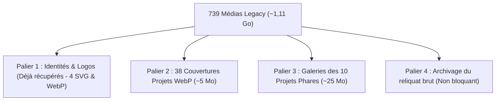

# ADP WEB EXPERIENCE — Rapport 02B-06 : Audit Approfondi des Médias & Stratégie de Récupération

**Date :** 27 octobre 2026  
**Auteurs :** Développeur Frontend, Responsable QA, Architecte Logiciel  
**Projet :** ADP WEB EXPERIENCE  
**Sources de données :**
- Arbre Git complet (`git ls-tree -r --name-only HEAD`)
- Références textuelles extraites de l'ensemble des fichiers HTML, CSS et JS  

---

## 1. Vue d'ensemble chiffrée du parc de médias

L'investigation automatisée sur l'ensemble de l'historique et des sources produit les indicateurs clés suivants :

| Métrique | Valeur vérifiée | Analyse technique |
|---|---|---|
| **Total des fichiers médias trackés dans Git** | **739 fichiers** | Concentrés dans `assets/` et `public/` (325 `.webp`, 218 `.jpg`, 162 `.png`, 27 `.jpeg`, 4 `.svg`, 2 `.pdf`, 1 `.vcf`). |
| **Poids estimé des médias distants** | **~1,11 Go** | Responsable direct des coupures réseau et échecs de clone observés à l'étape 01. |
| **Total des médias référencés dans le code** | **470 références uniques** | Fichiers activement appelés par des balises ``, `<source>`, `background-image` ou `<meta>`. |
| **Médias trackés dans Git MAIS non référencés (orphelins)** | **287 fichiers** | Images, captures intermédiaires ou variantes conservées dans le dépôt sans être affichées sur le site. |
| **Médias référencés dans le code MAIS absents de Git (fantômes)** | **18 fichiers** | Essentiellement des images Open Graph (`og-home.jpg`, etc.) ou des visuels manquants. |
| **Doublons de formats détectés** | **317 paires d'assets** | Même image présente sous son format source (`.png`/`.jpg`) ET sous sa version compressée (`.webp`). |

---

## 2. Détection des doublons de formats et redondances

Sur les 739 fichiers binaires du dépôt distant, **317 images existent en double exemplaire** dans le même sous-dossier ou dans des répertoires parallèles :

### Exemples représentatifs vérifiés :
- **Identités et logos :**
  - `assets/paul/brand/adp.png` ET `assets/paul/brand/adp.webp`
  - `assets/paul/identities/academy.png` ET `assets/paul/identities/academy.webp`
  - `assets/paul/identities/brief.png` ET `assets/paul/identities/brief.webp`
  - `assets/paul/identities/lab.png` ET `assets/paul/identities/lab.webp`
  - `assets/paul/identities/project.png` ET `assets/paul/identities/project.webp`
- **Projets d'architecture :**
  - `assets/projects/bicec_bafoussam/bicec_1.jpg` ET `bicec_1.webp`
  - `assets/projects/web_tower/web_holding_cover.jpg` ET `web_holding_cover.webp`
  - `assets/projects/sequoia/Capture.PNG` ET `Capture.webp`
  - `assets/projects/suka_cafe/suka_12.jpg` ET `suka_12.webp`

### Explication de la dette de stockage :
Le script [scratch/optimize_images.py](file:///d:/05_ADP_SOFTWARE/00_ADP%20WEB%20EXPERIENCE/01_LEGACY/paul-boubert-portfolio/scratch/optimize_images.py) et [scratch/push_folders.py](file:///d:/05_ADP_SOFTWARE/00_ADP%20WEB%20EXPERIENCE/01_LEGACY/paul-boubert-portfolio/scratch/push_folders.py) révèlent que l'équipe historique a converti les photos d'origine en WebP pour améliorer le temps de chargement, **mais a conservé les fichiers PNG/JPG d'origine dans Git comme source de fallback**, doublant instantanément la taille du dépôt sur GitHub.

---

## 3. Analyse des 287 médias orphelins (Non référencés dans le code)

L'analyse croisée entre `git ls-tree` et les fichiers HTML/CSS montre que 287 fichiers ne figurent dans aucun fichier source :

### Catégories d'orphelins identifiées :
1. **Rendus intermédiaires et exports de travail :**
   - Nombreux fichiers préfixés `Enscape_2024-...` ou `Capture2.PNG`, `Capture3.PNG` dans les dossiers de projets (ex. `assets/projects/web_tower/`, `assets/projects/sequoia/`) qui correspondent à des essais de cadrage 3D non retenus dans les galeries finales.
2. **Anciennes bannières ou versions abandonnées :**
   - Variantes nommées `hero_v1`, `hero_v2`, `web_holding_cover_v2.jpg` cohabitant avec la version finale.
3. **Images de projets retirés du site :**
   - Le script `scratch/remove_specific_projects.py` prouve que certains projets ont été dépubliés du code HTML, mais que leurs dossiers de photos sont restés stockés dans l'arborescence Git `assets/projects/`.

*Règle de sécurité respectée : Ces fichiers ne doivent en aucun cas être supprimés du dépôt legacy. Ils constituent une archive brute précieuse pour sélectionner ultérieurement de nouveaux visuels pour la refonte.*

---

## 4. Analyse des 18 médias manquants (Erreurs 404 potentielles)

18 fichiers sont explicitement appelés par le code mais ne figurent pas dans l'arbre Git HEAD :
- **Images de partage social :**
  - `assets/og/og-home.jpg`
  - `assets/og/og-apropos.jpg`
  - `assets/og/og-adp.jpg`
  - `assets/og/og-academy.jpg`
  - `assets/og/og-brief.jpg`
  - `assets/og/og-lab.jpg`
  - `assets/og/og-studio.jpg`
  - `assets/og/og-tools.jpg`
  - `assets/og/og-portfolio.jpg`
  - `assets/og/og-contact.jpg`
  - `assets/og/og-ressources.jpg`
- **Images de projets :**
  - `assets/projects/cabinet_elena/hero.webp` et `hero.jpg` (appelés dans le randomizer de l'accueil ligne 103 d'`index.html` et dans le carrousel ligne 223, mais absents de l'arbre).

---

## 5. Stratégie de récupération sélective pour la refonte

Pour la conception de *The Possibility Machine*, le téléchargement global de 1,1 Go n'est ni nécessaire ni recommandé. Une approche chirurgicale en 4 paliers est préconisée :

### Détail des paliers d'extraction :
1. **Palier 1 — Identités de marque et icônes (Priorité absolue - Volume < 500 Ko) :**
   - Les 4 fichiers SVG (`favicon.svg`, `qr-paul.svg`, `sprite.svg`, `a-embossed.svg`) sont déjà présents localement.
   - Les logos des 7 pôles (`assets/identities/*.webp`).
2. **Palier 2 — Vignettes de couverture des 38 projets portfolio (Priorité haute - Volume ~5 Mo) :**
   - Télécharger uniquement **une seule image de couverture WebP** par projet (ex: `assets/projects/{slug}/hero.webp` ou `bicec_1.webp`).
   - Permet d'alimenter immédiatement la grille portfolio de la nouvelle maquette sans aucune image cassée.
3. **Palier 3 — Galeries complètes des 10 projets majeurs (Priorité moyenne - Volume ~25 Mo) :**
   - Sélectionner les 10 réalisations les plus prestigieuses (ex: BICEC Bafoussam, Web Tower, Showroom Kotto, 018 Studio, Bahemeck, etc.) pour intégrer leurs galeries HD dans les études de cas approfondies.
4. **Palier 4 — Archivage et élimination des doublons :**
   - Ne pas rapatrier les fichiers PNG/JPG bruts redondants ni les 287 fichiers orphelins sur l'espace de travail local.
   - Les conserver dans le dépôt GitHub distant comme coffre-fort d'archives.
