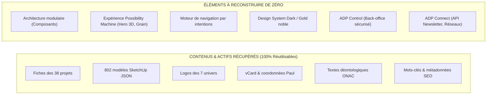

# ADP WEB EXPERIENCE — Rapport 02B-08 : Décision Finale, Arbitrages & Feuille de Route

**Date :** 27 octobre 2026  
**Auteurs :** Le Comité des Dix Experts Réuni  
**Projet :** ADP WEB EXPERIENCE  
**Cible :** Transition depuis `01_LEGACY/paul-boubert-portfolio/` vers la nouvelle plateforme  
**Statut :** Recommandation unanime du comité soumise à la validation de la direction  

---

## 1. Les Dix Principales Forces de l'Ancien Projet

1. **Richesse du contenu architectural :** 38 études de cas réelles documentées avec fiches techniques (programmes, surfaces, typologies, logiciels).
2. **Clarté du positionnement de marque :** Identité forte ancrée au Cameroun et dans la sous-région d'Afrique centrale.
3. **Architecture des 7 identités complémentaires :** Découpage métier cohérent (Project, Studio, Rosbri, Brief, Lab, Academy, Tools).
4. **Réassurance déontologique :** Engagement formel et visible de conformité avec l'Ordre National des Architectes du Cameroun (ONAC).
5. **Catalogue de ressources 3D :** Base structurée de 802 modèles SketchUp avec liens directs de téléchargement.
6. **Balisage sémantique & SEO local :** Données structurées Schema.org (`ProfessionalService`, `BreadcrumbList`) et balises canoniques bien positionnées.
7. **Carte de visite numérique `/paul` :** Outil de contact mobile direct et fichier vCard 3.0 très efficace sur le terrain.
8. **Configuration de déploiement Vercel :** Routage propre (`cleanUrls: true`), redirections 301 historiques et gestion des en-têtes de cache.
9. **Logos et identités visuelles vectorielles :** Éléments de marque déjà créés et optimisés (SVG et WebP).
10. **Reflet d'une vision de communication globale :** L'ébauche de calendrier éditorial multi-plateformes (`POST/`) témoigne d'une maturité stratégique certaine.

---

## 2. Les Dix Principales Faiblesses du Projet Legacy

1. **Architecture statique monolithique éclatée :** 62 pages HTML dupliquant l'en-tête, le pied de page et les métadonnées sans aucun système de composants.
2. **Maintenance artisanale à base de Regex :** Utilisation de scripts Node.js locaux (`sync-identities.cjs`) manipulant les fichiers HTML bruts par expressions régulières, source majeure d'instabilité.
3. **Absence totale de base de données et de CMS :** Aucun back-office, impossible de modifier un projet ou une identité sans éditer le code source.
4. **Poids colossal du dépôt Git distant (1,11 Go) :** Présence de 739 fichiers médias, dont 317 doublons de formats et 287 images orphelines non référencées.
5. **Ergonomie du curseur custom désastreuse pour l'accessibilité :** Règle globale `* { cursor: none }` handicapante pour les utilisateurs de pointeurs fins et d'outils d'assistance.
6. **Fausse fonctionnalité de newsletter :** Formulaire envoyant un email via Web3Forms sans abonnement à une véritable plateforme d'emailing ni opt-in conforme.
7. **Absence de stockage pérenne des demandes de devis :** Perte de données garantie en cas de problème de distribution de l'email ou de quota API tiers.
8. **18 images Open Graph manquantes dans le dépôt :** Dégradation visuelle systématique lors des partages de liens sur les réseaux sociaux.
9. **Exposition en clair d'une clé API publique :** Clé Web3Forms accessible dans le code client sans protection serveur.
10. **Expérience utilisateur linéaire et passive :** Site vitrine d'ancienne génération, très éloigné de l'immersion sensorielle et interactive promise par *The Possibility Machine*.

---

## 3. Matrice de Récupération vs Reconstruction



---

## 4. Scénario Recommandé par le Comité

Le comité des dix experts recommande **à l'unanimité** l'adoption de la **Stratégie C : Nouvelle application modulaire avec migration des contenus utiles**, articulée comme suit :

1. **Socle technique :** Architecture modulaire moderne (Vite / Next.js ou Astro) avec templating par composants stricts (`<Header />`, `<Footer />`, `<UniverseGrid />`, `<ProjectCard />`, `<ContactDock />`).
2. **Expérience utilisateur :** Implémentation fidèle de la maquette [ADP_Possibility_Machine_Prototype.html](file:///d:/05_ADP_SOFTWARE/00_ADP%20WEB%20EXPERIENCE/ADP_Possibility_Machine_Prototype.html) (Dark mode `#0C1422`, sculpture 3D CSS *Possibility Core*, grain argentique, sélection d'intentions réactive).
3. **Ingestion des contenus :** Extraction automatisée du texte des 38 projets et des 802 modèles 3D vers des fichiers de contenu structurés (Markdown avec frontmatter ou collection JSON unifiée).
4. **Administration et Communication :** Conception des modules légers et sécurisés *ADP Control* et *ADP Connect*.

---

## 5. Feuille de Route en 5 Phases

```text
PHASE 1 : FONDATIONS & DESIGN SYSTEM (The Possibility Machine)
├── Initialisation du projet applicatif dans ADP_WEB_EXPERIENCE
├── Configuration de l'environnement de build et des tokens de design
├── Implémentation du Core 3D, du grain CSS et de la navigation par intentions
└── Intégration du composant Dock flottant et de l'accessibilité (prefers-reduced-motion)

PHASE 2 : ARCHITECTURE DES 7 UNIVERS & ROUTAGE CANONIQUE
├── Création du moteur de templates universel pour les 7 identités
├── Génération des routes : /adp-project/, /adp-studio/, /rosbri-design/, etc.
├── Préservation stricte de la page /paul et de la vCard 3.0
└── Implémentation des règles de redirection SEO 301 conformes à vercel.json

PHASE 3 : MIGRATION DU CATALOGUE DE PROJETS & RESSOURCES 3D
├── Ingestion automatisée des textes et caractéristiques des 38 projets d'architecture
├── Téléchargement sélectif des 38 visuels WebP de couverture (Palier 2 de l'audit médias)
├── Création de la galerie dynamique de projets avec filtres instantanés
└── Intégration de la visionneuse des 802 modèles SketchUp

PHASE 4 : ADP CONTROL & ADP CONNECT
├── Conception de l'interface d'administration protégée (ADP Control)
├── Module de réception et de stockage sécurisé des demandes de devis
├── Raccordement de la newsletter à un service d'emailing professionnel (opt-in réel)
└── Interface de gestion des publications sociales (ADP Connect)

PHASE 5 : ASSURANCE QUALITÉ, CYBERSÉCURITÉ & DÉPLOIEMENT
├── Audit Lighthouse (Performance > 95, Accessibilité 100, SEO 100)
├── Vérification sur écrans réels (Mobile iOS/Android, Tablettes, Desktop)
├── Sécurisation des en-têtes HTTP (CSP stricte, HSTS, protection contre les injections)
└── Déploiement en production sur ateliersdepaul.com via Vercel
```

---

## 6. La Toute Première Intervention à Réaliser (Étape 03)

La première étape opérationnelle consistera à :
👉 **Scaffolder le socle technique moderne de l'application à la racine de `ADP_WEB_EXPERIENCE`, configurer les variables CSS de la *Possibility Machine* et intégrer le composant vivant *The Possibility Core* sans toucher aux répertoires `01_LEGACY/` et `02_AUDIT/`.**
