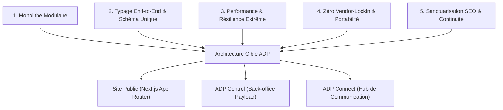
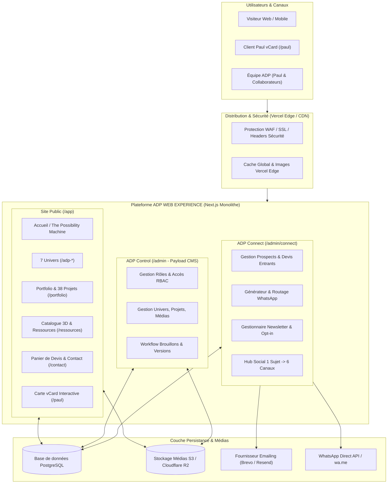

# ADP WEB EXPERIENCE — Rapport 03A-01 : Vision Globale et Principes d'Architecture

**Date :** 27 octobre 2026  
**Auteurs :** Architecte Logiciel Senior, Expert Next.js / TypeScript, Designer UX/UI  
**Projet :** ADP WEB EXPERIENCE (`ateliersdepaul.com`)  
**Statut :** Document de conception préliminaire — Étape 03A  

---

## 1. Contexte, Identité et Vision Stratégique

Le projet **ADP WEB EXPERIENCE** constitue la refonte intégrale de la présence numérique des **Ateliers de Paul** (`ateliersdepaul.com`).

- **Concept créatif :** *THE POSSIBILITY MACHINE*
- **Signature de marque :** *Une idée. Mille possibilités.*
- **Direction artistique :** *Fusion Atelier vivant + Matière en mouvement*.
- **Posture visuelle :** **Thème clair sophistiqué par défaut** (fond pierre/ivoire minéral noble, lin naturel, accents métalliques d'atelier, typographies géométriques et contrastées), complété par un **mode sombre optionnel** sélectionnable par l'utilisateur, et non imposé.

L'objectif est d'abandonner le modèle passif de "vitrine statique d'architecte" pour donner naissance à une **plateforme vivante d'ingénierie et de création**, structurée autour de trois piliers complémentaires :
1. **Le Site Public immersif :** Vitrine d'excellence articulée autour de la navigation par intentions et des 7 univers.
2. **ADP Control :** Système de gestion de contenu (CMS) centralisé, headless et unifié, pour administrer sans coder les univers, les projets, les ressources, les fiches et les demandes de devis.
3. **ADP Connect :** Hub de communication opérationnel pour centraliser les opportunités, canaliser les échanges vers WhatsApp prioritaire, animer la newsletter et orchestrer les publications multi-réseaux.

---

## 2. Principes d'Architecture Directeurs

Le comité d'ingénierie a fixé cinq principes non négociables pour guider l'ensemble des choix techniques :

### 2.1. Principe 1 : Monolithe Modulaire (Modular Monolith)
- **Choix délibéré :** Rejet catégorique d'une architecture en microservices prématurée (plusieurs dépôts, plusieurs serveurs, synchronisation de contrats d'API distants, latence réseau interne, complexité DevOps disproportionnée).
- **Implémentation :** Un **dépôt unique (Single Codebase)** et une **application unifiée** où le frontend public, l'API métier et le panneau d'administration (ADP Control) cohabitent dans le même runtime Node.js / Next.js, tout en étant strictement isolés en modules métiers étanches au niveau du code (`modules/universes`, `modules/projects`, `modules/quotes`, `modules/connect`).

### 2.2. Principe 2 : Typage Strict de Bout en Bout (End-to-End Type Safety)
- Le modèle de données défini dans PostgreSQL / Payload CMS génère automatiquement les définitions de types TypeScript.
- Les composants React du site public consomment ces types natifs sans aucune conversion manuelle, éliminant 100% des erreurs d'incohérence entre la base de données et l'affichage.

### 2.3. Principe 3 : Performance & Rendu Hybride Optimal (ISR / SSR / Client)
- **Contenus publics (95% du trafic) :** Pré-générés statiquement (SSG) et rafraîchis à la demande par revalidation incrémentale (*Incremental Static Regeneration - ISR*). Le temps de réponse (TTFB) est inférieur à 100 ms sur le réseau CDN mondial de Vercel.
- **Interactions dynamiques (Recherche, Panier de devis, Filtres) :** Composants clients légers sans framework CSS lourd, hydratés uniquement lorsque nécessaire.
- **Back-office ADP Control & Connect (5% du trafic) :** Rendu dynamique côté serveur (SSR) protégé par session sécurisée.

### 2.4. Principe 4 : Zéro Verrouillage Propriétaire & Portabilité des Données
- Le stockage repose sur **PostgreSQL standard** (hébergeable chez Supabase, Neon, AWS RDS ou un VPS local).
- Les médias sont stockés sur un stockage objet compatible **S3 standard** (Cloudflare R2 ou AWS S3).
- Les données peuvent être exportées en JSON ou SQL en un clic à tout moment.

### 2.5. Principe 5 : Sanctuarisation SEO & Pérennité des URL
- Les 69 URL historiques identifiées lors de l'audit 02B (notamment les 38 projets d'architecture, les 7 pôles et la page `/paul`) sont cartographiées et préservées avec un code HTTP 200 direct ou une redirection 301 sans rupture.

---

## 3. Schéma Fonctionnel Global de la Plateforme

---

## 4. Découpage Modulaire des Responsabilités

| Sous-système | Responsabilité principale | Mode d'accès | Cible d'audience |
|---|---|---|---|
| **Moteur Public** | Rendu des pages, sculpture animée, intentions, filtres et consultation de projets | URLs publiques (`/`, `/portfolio`, etc.) | Prospects, clients, partenaires, grand public |
| **Moteur de Devis** | Mémorisation locale des services/produits sélectionnés et transmission structurée | Composant tiroir / Drawer modal | Visiteurs avec intention d'achat ou de projet |
| **ADP Control** | CRUD complet des contenus, validation éditoriale, gestion des médias et des rôles | Interface sécurisée (`/admin`) | Paul Boubert et équipe éditoriale autorisée |
| **ADP Connect** | Suivi des leads entrants, dispatch WhatsApp, orchestration des publications sociales | Module interne (`/admin/connect`) | Direction et responsable communication |

---

## 5. Alignement avec les Conclusions de l'Audit 02B

L'architecture conçue répond point par point aux 10 faiblesses identifiées lors de l'étape 02B :
- **Élimination des 62 fichiers HTML dupliqués :** Remplacés par un système de composants React et de pages dynamiques alimentées par la base PostgreSQL.
- **Suppression définitive des scripts Regex :** La synchronisation des logos et des menus est automatique via le composant unique `<Navbar />`.
- **Assainissement des médias :** Les 1,11 Go de médias désordonnés sont remplacés par une médiathèque centralisée ne stockant que les visuels WebP optimisés.
- **Rétablissement de l'accessibilité :** Le curseur CSS natif est restauré, le custom cursor désactivé, et le support de `prefers-reduced-motion` est intégré au cœur de l'expérience interactive.
