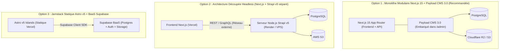

# ADP WEB EXPERIENCE — Rapport 03A-02 : Étude Comparative et Sélection de la Stack Technique

**Date :** 27 octobre 2026  
**Auteurs :** Architecte Logiciel Senior, Expert Next.js / TypeScript, Expert CMS Headless, Responsable DevOps  
**Projet :** ADP WEB EXPERIENCE (`ateliersdepaul.com`)  
**Statut :** Document de conception technique — Étape 03A  

---

## 1. Objectif de l'Étude

Le présent document évalue de manière critique et impartiale les options technologiques candidates pour l'implémentation de la plateforme unifiée **ADP WEB EXPERIENCE** (Site Public, ADP Control, ADP Connect).

Conformément aux directives de l'étape 03A :
- Aucune stack n'a été pré-approuvée sans benchmark ;
- Les versions, licences, conditions d'hébergement, coûts réels, simplicité d'exploitation et portabilité des données sont rigoureusement confrontés ;
- Le principe directeur est celui du **monolithe modulaire** pour éradiquer la complexité opérationnelle prématurée.

---

## 2. Benchmark Comparatif des 3 Architectures Candidates

Trois architectures réalistes ont été modélisées et soumises aux exigences du projet :

### 2.1. Tableau d'Évaluation Multicritère

| Critère d'évaluation | Option 1 : Next.js 15 + Payload 3.0 (Monolithe) | Option 2 : Next.js + Strapi v5 (Découplé) | Option 3 : Astro v5 + Supabase (BaaS) |
|---|:---:|:---:|:---:|
| **Architecture logicielle** | Monolithe modulaire unifié | Deux applications séparées (Frontend + CMS) | Hybride Statique / BaaS externe |
| **Partage des types TypeScript** | **Natif & automatique (End-to-End)** | Manuel ou via codegen API distant | Partiel (via Supabase CLI codegen) |
| **Complexité DevOps / Déploiement** | **Faible : 1 seul pipeline CI/CD (Vercel)** | Élevée : 2 serveurs, 2 déploiements, CORS | Moyenne : 1 frontend Vercel + Console BaaS |
| **Performance d'affichage (ISR/SSG)** | **Excellente (<100 ms via cache Vercel)** | Bonne (revalidation par webhook Strapi) | Maximale (statique HTML pur) |
| **Expérience Back-office (Admin UX)** | **Sur-mesure React, fluide, unifiée** | Interface Strapi lourde, rigide | Console Supabase générique, non éditoriale |
| **Licence logicielle** | **MIT (Open Source 100% permissif)** | BSL / EE payante sur fonctions avancées | Apache 2.0 (Self-host) ou Cloud SaaS |
| **Portabilité des données** | **100% PostgreSQL standard (zéro lock-in)** | 100% PostgreSQL standard | Standard PostgreSQL + dépendances auth |
| **Gestion des médias** | S3 / Cloudflare R2 direct | S3 via plugin Strapi | Supabase Storage (S3 compatible) |
| **Coût d'exploitation mensuel (Démarrage)** | **0 € à 20 € / mois** | 25 € à 50 € / mois (serveur CMS dédié) | 0 € à 25 € / mois |
| **Note globale du comité** | **18,5 / 20 (Choix n°1)** | 13 / 20 | 15 / 20 |

---

## 3. Justification Technique de la Stack Sélectionnée

Le comité d'architecture retient la solution **Option 1 : Monolithe Modulaire Next.js 15 + Payload CMS 3.0**.

### 3.1. Pourquoi Payload CMS 3.0 change la donne ?
Jusqu'à la version 2.x, Payload nécessitait un serveur Express dédié. Depuis la version 3.0, **Payload s'exécute nativement au sein de l'App Router de Next.js** en tant que composant et route API standard (`/app/(payload)/admin`).
- **Zéro serveur secondaire :** Plus besoin de maintenir un conteneur Docker séparé pour le back-office.
- **Accès direct à la base de données :** Les Server Components de Next.js peuvent interroger la base de données locale via l'API locale Payload (`payload.find()`) sans aucune requête HTTP externe, éliminant toute latence réseau inter-services.
- **Typage instantané :** La commande `payload generate:types` produit un fichier `payload-types.ts` consommé directement par les composants UI du site public.

### 3.2. Spécification détaillée des composants de la stack

#### A. Moteur Applicatif & Frontend
- **Framework :** Next.js 15 (App Router, React 19, Node.js 20+ LTS).
- **Langage :** TypeScript 5.6+ en mode `strict: true`.
- **Rendu :**
  - Pages publiques (Accueil, Univers, Projets, Ressources, vCard `/paul`) : Pré-rendu statique (SSG) avec revalidation incrémentale à la demande (ISR).
  - Recherche, Panier de Devis, Interactions Possibility Core : Client Components React ultra-légers.
  - Administration ADP Control & Connect : Server-Side Rendering (SSR) protégé par session sécurisée.

#### B. Système de Design & CSS
- **Choix délibéré :** **Vanilla CSS moderne & CSS Modules**.
- **Justification contre Tailwind CSS :**
  - Conformément aux directives architecturales, le projet exige une identité visuelle d'orfèvrerie : grain argentique, sculpture géométrique 3D en rotation CSS, contrastes minéraux fins, typographies d'atelier et animations fluides à 60 fps.
  - L'usage de classes utilitaires kilométriques dans le DOM nuit à la lisibilité et restreint la finesse des animations matricielles du Possibility Core.
  - Le design system sera structuré en variables CSS natives (`tokens.css`), garantissant un switch instantané Thème Clair Minéral (défaut) / Thème Sombre d'Atelier (optionnel).

#### C. Base de Données Relationnelle
- **Moteur :** **PostgreSQL 16+**.
- **ORM / Adaptateur :** `@payloadcms/db-postgres` (propulsé par Drizzle ORM sous le capot).
- **Portabilité :** Schéma relationnel standard. Les sauvegardes `pg_dump` peuvent être restaurées sur n'importe quel serveur PostgreSQL (local, cloud, VPS).
- **Fournisseur recommandé :** **Neon Serverless PostgreSQL** ou **Supabase PostgreSQL** (offre gratuite généreuse couvrant les besoins de lancement, passage à 20-25 $/mois en production intensive).

#### D. Stockage des Médias & Objets
- **Stockage cible :** Compatible **Amazon S3 API** via le plugin `@payloadcms/plugin-cloud-storage`.
- **Fournisseur recommandé :** **Cloudflare R2**.
  - **Avantage décisif :** **0 $ de frais de transfert sortant (Zero Egress Fees)**, contrairement à AWS S3 qui facture chaque giga-octet téléchargé par les visiteurs.
  - Stockage de 10 Go gratuit, puis 0,015 $/Go/mois.
  - Domaine personnalisé avec CDN mondial Cloudflare ultra-rapide et SSL automatique.

#### E. Moteur d'Animation et Micro-interactions
- **The Possibility Core :** CSS 3D Transforms matériellement accélérées (`transform-style: preserve-3d`, `perspective`, `matrix3d`) et SVG dynamique.
- **Transitions d'interface :** Web Animations API native et transitions CSS optimisées (`will-change: transform, opacity`).
- **Accessibilité :** Respect strict de `prefers-reduced-motion` : bascule instantanée en vue statique noble sans mouvement pour les utilisateurs sensibles.

#### F. Services Métiers & Tiers Intégrés
- **Emailing Transactionnel & Newsletter (ADP Connect) :** **Resend API** ou **Brevo API**.
  - Envoi des notifications de devis à l'administrateur et confirmation au client.
  - Double opt-in conforme pour la newsletter avec stockage des preuves de consentement.
- **Canal WhatsApp Prioritaire :**
  - Phase 1 (MVP) : Générateur de liens profonds universels `https://wa.me/237690087213?text=...` encodant dynamiquement le récapitulatif du brief ou des articles sélectionnés.
  - Phase 2 : Raccordement à l'API WhatsApp Cloud (Meta Business) pour l'archivage automatique des fils de discussion dans ADP Connect.

---

## 4. Analyse Économique et Coût Total de Possession (TCO)

Le modèle économique d'exploitation est maîtrisé dès la phase de lancement :

| Poste de coût | Fournisseur / Solution | Coût MVP (Lancement) | Coût Vitesse de croisière |
|---|---|:---:|:---:|
| **Hébergement Web & Edge CDN** | Vercel (Hobby / Pro) | 0 € / mois | 20 $ / mois |
| **Base de Données PostgreSQL** | Neon / Supabase (Free tier) | 0 € / mois | 25 $ / mois |
| **Stockage Médias (10 à 50 Go)** | Cloudflare R2 | 0 € / mois | ~1 à 3 $ / mois |
| **Nom de domaine (`ateliersdepaul.com`)** | Registrar existant | ~15 € / an | ~15 € / an |
| **Envois Emails / Newsletter** | Resend (3 000 emails/mois free) | 0 € / mois | 20 $ / mois |
| **Licence CMS** | Payload CMS 3.0 (MIT) | **0 € (Gratuit à vie)** | **0 €** |
| **TOTAL ESTIMÉ** | — | **0 € à 15 € / an** | **~45 à 68 $ / mois** |

---

## 5. Synthèse et Validation par les Experts

1. **Architecte Logiciel :** Le choix du monolithe modulaire élimine 80% des pannes réseau potentielles entre un frontend séparé et un CMS distant.
2. **Expert Next.js :** L'intégration native de Payload 3.0 dans l'App Router garantit une réactivité extrême et un SSR fluide pour le back-office.
3. **Architecte BDD :** PostgreSQL assure la pérennité totale des données, la gestion des relations complexes des 7 univers et l'indépendance vis-à-vis des hébergeurs.
4. **Responsable DevOps :** Un seul dépôt Git, un seul déploiement atomique sur Vercel, zéro serveur Linux à patcher manuellement au démarrage.
