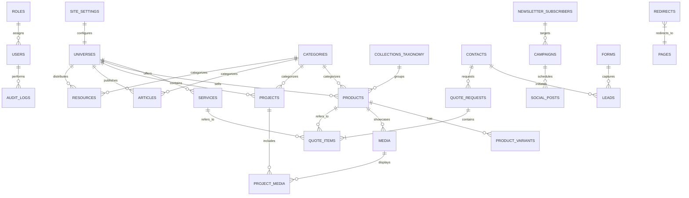

# ADP WEB EXPERIENCE — Rapport 03A-03 : Modèle de Données et Schéma Relationnel

**Date :** 27 octobre 2026  
**Auteurs :** Architecte de Bases de Données PostgreSQL, Expert CMS Headless, Architecte Logiciel Senior  
**Projet :** ADP WEB EXPERIENCE (`ateliersdepaul.com`)  
**Statut :** Spécification technique formelle du schéma de données — Étape 03A  

---

## 1. Principes Directeurs du Modèle de Données

Le modèle de données de **ADP WEB EXPERIENCE** est conçu pour unifier sous un même schéma PostgreSQL les contenus du **Site Public**, les opérations d'**ADP Control** et les flux d'**ADP Connect**.

Cinq règles fondamentales gouvernent sa conception :
1. **Normalisation & Zéro Doublon :** Élimination des duplications de données constatées dans le legacy (ex. 62 variantes de textes, coordonnées copiées en dur).
2. **Polymorphisme des 7 Univers :** Une table pivot `universes` relie harmonieusement les projets d'architecture (ADP Project), les créations graphiques (ADP Studio), les collections de mode (Rosbri Wax Design), les articles d'analyse (ADP Brief & Lab), les formations (ADP Academy) et les logiciels (ADP Tools).
3. **Séparation Stricte MVP vs Versions Ultérieures :** Identification claire des 14 collections vitales pour le lancement (MVP) et des 11 collections activées en phases 2 et 3.
4. **Intégrité Référentielle & Traçabilité :** Clés étrangères obligatoires, index b-tree systématiques sur les clés et slugs, journalisation fine des mutations via `audit_logs`.
5. **Politique d'Archivage Doux (Soft Delete) :** Les données sensibles (contacts, devis, projets) disposent d'un champ `deleted_at` pour empêcher toute perte accidentelle.

---

## 2. Diagramme Entité-Relation Global (Mermaid ERD)

---

## 3. Matrice de Répartition MVP vs Phases Ultérieures

| Catégorie | Nom de la Collection | Phase | Rôle fonctionnel principal |
|---|---|:---:|---|
| **Sécurité & Accès** | `users` | **MVP** | Comptes administrateurs, éditeurs et collaborateurs |
| **Sécurité & Accès** | `roles` | **MVP** | Définition des permissions RBAC |
| **Sécurité & Accès** | `audit_logs` | **MVP** | Traçabilité des actions et modifications |
| **Structure & Pages** | `universes` | **MVP** | Définition des 7 univers (thème, couleurs, métadonnées) |
| **Structure & Pages** | `pages` | **MVP** | Pages éditoriales (Accueil, À propos, Mentions, vCard `/paul`) |
| **Structure & Pages** | `redirects` | **MVP** | Préservation des 69 URL historiques (301 permanentes) |
| **Structure & Pages** | `site_settings` | **MVP** | Paramètres globaux (coordonnées, SEO défaut, WhatsApp) |
| **Contenus Métiers** | `projects` | **MVP** | Études de cas (38 projets architecturaux historiques + nouveaux) |
| **Contenus Métiers** | `project_media` | **MVP** | Ordre et métadonnées des galeries photos de projets |
| **Contenus Métiers** | `media` | **MVP** | Médiathèque centralisée (S3 / R2, alt, dimensions, WebP) |
| **Contenus Métiers** | `resources` | **MVP** | Catalogue des 802 modèles SketchUp et livrables téléchargeables |
| **Contenus Métiers** | `categories` | **MVP** | Taxonomie hiérarchique partagée |
| **Contenus Métiers** | `services` | **MVP** | Fiches de prestations des 7 univers |
| **Devis & Contact** | `contacts` | **MVP** | Carnet d'adresses centralisé |
| **Devis & Contact** | `quote_requests` | **MVP** | Paniers de demande de devis soumis |
| **Devis & Contact** | `quote_items` | **MVP** | Détail des prestations sélectionnées dans un devis |
| **Devis & Contact** | `forms` | **MVP** | Formulaire de contact général et formulaires spécifiques |
| **Communication** | `newsletter_subscribers`| **MVP** | Inscriptions newsletter avec consentement RGPD/loi CM |
| **Commerce / Mode** | `products` | *Phase 2* | Produits physiques (Rosbri) et numériques (Tools, Studio) |
| **Commerce / Mode** | `product_variants` | *Phase 2* | Tailles, coloris, licences, déclinaisons |
| **Commerce / Mode** | `collections_tax` | *Phase 2* | Capsules de mode et séries limitées |
| **Contenus R&D** | `articles` | *Phase 2* | Publications Lab, Brief, Academy |
| **CRM Avancé** | `leads` | *Phase 2* | Pipeline commercial et qualification d'opportunités |
| **Communication** | `social_posts` | *Phase 2* | Hub éditorial 1 sujet -> 6 réseaux sociaux |
| **Communication** | `campaigns` | *Phase 3* | Campagnes d'emailing automatisées |

---

## 4. Spécification Détaillée des 25 Collections

---

### 1. `users` (Utilisateurs Internes)
- **Fonction :** Gestion des accès d'administration à ADP Control et ADP Connect.
- **Champs & Types :**
  - `id` : `UUID` (Primary Key, auto-généré)
  - `email` : `VARCHAR(255)` (Unique, format email valide)
  - `password_hash` : `VARCHAR(255)` (Argon2id)
  - `first_name` : `VARCHAR(100)` (Requis)
  - `last_name` : `VARCHAR(100)` (Requis)
  - `role_id` : `UUID` (Foreign Key -> `roles.id`, Requis)
  - `avatar_id` : `UUID` (Nullable, FK -> `media.id`)
  - `status` : `ENUM('active', 'suspended', 'pending')` (Défaut : `'pending'`)
  - `last_login_at` : `TIMESTAMPTZ` (Nullable)
  - `failed_login_attempts` : `INT` (Défaut : 0)
  - `lockout_until` : `TIMESTAMPTZ` (Nullable)
  - `created_at` / `updated_at` : `TIMESTAMPTZ`
  - `deleted_at` : `TIMESTAMPTZ` (Nullable, Soft Delete)
- **Permissions :** Lecture/Écriture restreinte au SuperAdmin ; consultation de son profil par l'utilisateur connecté.
- **Index :** `users_email_idx` (Unique), `users_role_id_idx`.

---

### 2. `roles` (Rôles et Permissions RBAC)
- **Fonction :** Définition des niveaux d'autorisation dans le système.
- **Champs & Types :**
  - `id` : `UUID` (Primary Key)
  - `name` : `VARCHAR(50)` (Unique : `'super_admin'`, `'editor'`, `'commercial'`, `'author'`)
  - `display_name` : `VARCHAR(100)` (Ex. *"Administrateur Général"*, *"Rédacteur"*)
  - `permissions` : `JSONB` (Structure des droits : `{ "projects": ["create", "read", "update", "delete", "publish"], "quotes": ["read", "update"] }`)
  - `created_at` / `updated_at` : `TIMESTAMPTZ`
- **Politique :** Rôles système non supprimables.

---

### 3. `universes` (Les Sept Pôles ADP)
- **Fonction :** Configuration centrale et métadonnées d'identité des 7 univers.
- **Champs & Types :**
  - `id` : `UUID` (Primary Key)
  - `code` : `VARCHAR(20)` (Unique, ex : `'project'`, `'studio'`, `'rosbri'`, `'brief'`, `'lab'`, `'academy'`, `'tools'`)
  - `order` : `INT` (Ordre d'affichage 1 à 7, Unique)
  - `name` : `VARCHAR(100)` (Ex. *"ADP Project"*, *"Rosbri Wax Design"*)
  - `tagline` : `VARCHAR(255)` (Sous-titre, ex. *"Architecture · BIM · 3D"*)
  - `slug` : `VARCHAR(100)` (Unique, ex : `'adp-project'`, `'rosbri-design'`)
  - `accent_color` : `VARCHAR(7)` (Code hexadécimal, ex : `'#7db9dc'`, format regex `^#[0-9A-Fa-f]{6}$`)
  - `symbol` : `VARCHAR(10)` (Glyphe atelier, ex : `'⌂'`, `'✦'`, `'❋'`)
  - `description` : `TEXT` (Présentation générale de l'univers)
  - `regulatory_notice` : `TEXT` (Mention déontologique ONAC obligatoire pour ADP Project)
  - `hero_image_id` : `UUID` (FK -> `media.id`, Nullable)
  - `seo_title` : `VARCHAR(70)`
  - `seo_description` : `VARCHAR(160)`
  - `is_active` : `BOOLEAN` (Défaut : `true`)
  - `created_at` / `updated_at` : `TIMESTAMPTZ`
- **Contrainte :** Exactly 7 entités de base au lancement.

---

### 4. `pages` (Pages Éditoriales et Statiques)
- **Fonction :** Gestion du contenu dynamique des pages maîtresses.
- **Champs & Types :**
  - `id` : `UUID` (Primary Key)
  - `slug` : `VARCHAR(150)` (Unique, ex : `'accueil'`, `'a-propos'`, `'paul'`, `'mentions-legales'`, `'politique-confidentialite'`, `'cadre-deontologique'`)
  - `title` : `VARCHAR(200)` (Requis)
  - `content_layout` : `JSONB` (Blocs de contenu modulaires : Hero, Texte, Grille, Citation, FAQ)
  - `seo_title` : `VARCHAR(70)`
  - `seo_description` : `VARCHAR(160)`
  - `og_image_id` : `UUID` (FK -> `media.id`)
  - `status` : `ENUM('draft', 'published', 'archived')` (Défaut : `'draft'`)
  - `published_at` : `TIMESTAMPTZ`
  - `created_at` / `updated_at` : `TIMESTAMPTZ`
- **Index :** `pages_slug_status_idx`.

---

### 5. `services` (Catalogue des Prestations par Univers)
- **Fonction :** Prestations proposées, rattachables au panier de devis.
- **Champs & Types :**
  - `id` : `UUID` (Primary Key)
  - `universe_id` : `UUID` (FK -> `universes.id`, Requis)
  - `category_id` : `UUID` (FK -> `categories.id`, Nullable)
  - `title` : `VARCHAR(200)` (Requis)
  - `slug` : `VARCHAR(200)` (Unique par univers)
  - `short_description` : `VARCHAR(300)`
  - `full_description` : `TEXT` (Markdown / RichText)
  - `deliverables` : `JSONB` (Liste des livrables inclus : plans PDF, maquette IFC, charte vectorielle)
  - `indicative_timeline` : `VARCHAR(100)` (Ex. *"2 à 4 semaines"*)
  - `price_indicator` : `VARCHAR(100)` (Ex. *"Sur devis"*, *"À partir de..."*)
  - `featured_image_id` : `UUID` (FK -> `media.id`)
  - `is_quotable` : `BOOLEAN` (Défaut : `true` - sélectionnable pour devis)
  - `status` : `ENUM('draft', 'published')`
  - `order` : `INT`
  - `created_at` / `updated_at` : `TIMESTAMPTZ`

---

### 6. `products` (Catalogue Produits — Phase 2)
- **Fonction :** Articles physiques (Rosbri Wax) ou numériques (ADP Tools / Studio).
- **Champs & Types :**
  - `id` : `UUID` (Primary Key)
  - `universe_id` : `UUID` (FK -> `universes.id`)
  - `collection_id` : `UUID` (FK -> `collections_tax.id`, Nullable)
  - `category_id` : `UUID` (FK -> `categories.id`)
  - `name` : `VARCHAR(255)` (Requis)
  - `slug` : `VARCHAR(255)` (Unique)
  - `sku` : `VARCHAR(50)` (Unique)
  - `product_type` : `ENUM('physical', 'digital_download', 'license')`
  - `description` : `TEXT`
  - `base_price` : `DECIMAL(12, 2)` (Nullable - pas de vente directe au MVP, indicateur pour devis)
  - `currency` : `VARCHAR(3)` (Défaut : `'XAF'`)
  - `thumbnail_id` : `UUID` (FK -> `media.id`)
  - `status` : `ENUM('draft', 'published', 'out_of_stock', 'archived')`
  - `created_at` / `updated_at` : `TIMESTAMPTZ`

---

### 7. `product_variants` (Variantes Produits — Phase 2)
- **Fonction :** Déclinaisons de tailles, motifs de cire africaine ou types de licence.
- **Champs & Types :**
  - `id` : `UUID` (Primary Key)
  - `product_id` : `UUID` (FK -> `products.id`, Requis, Cascade Delete)
  - `variant_sku` : `VARCHAR(70)` (Unique)
  - `option_name` : `VARCHAR(50)` (Ex : *"Taille"*, *"Motif"*, *"Licence"*)
  - `option_value` : `VARCHAR(100)` (Ex : *"L"*, *"Motif Écailles Or"*, *"Poste Unique"*)
  - `price_modifier` : `DECIMAL(10, 2)` (Défaut : `0.00`)
  - `stock_quantity` : `INT` (Défaut : 0)
  - `image_id` : `UUID` (FK -> `media.id`, Nullable)
  - `created_at` / `updated_at` : `TIMESTAMPTZ`

---

### 8. `categories` (Taxonomie Hiérarchique)
- **Fonction :** Catégorisation transversale pour les projets, produits, articles et ressources.
- **Champs & Types :**
  - `id` : `UUID` (Primary Key)
  - `universe_id` : `UUID` (FK -> `universes.id`, Requis)
  - `parent_id` : `UUID` (FK auto-référencée -> `categories.id`, Nullable)
  - `name` : `VARCHAR(150)` (Requis)
  - `slug` : `VARCHAR(150)` (Unique par univers)
  - `description` : `VARCHAR(255)`
  - `order` : `INT` (Défaut : 0)
  - `created_at` / `updated_at` : `TIMESTAMPTZ`
- **Index :** `categories_universe_slug_idx` (Unique composé).

---

### 9. `collections_tax` (Collections Éditoriales & Capsules — Phase 2)
- **Fonction :** Regroupements thématiques (ex. *"Capsule Rosbri Renaissance 2026"*).
- **Champs & Types :**
  - `id` : `UUID` (Primary Key)
  - `universe_id` : `UUID` (FK -> `universes.id`)
  - `title` : `VARCHAR(200)` (Requis)
  - `slug` : `VARCHAR(200)` (Unique)
  - `story` : `TEXT`
  - `cover_media_id` : `UUID` (FK -> `media.id`)
  - `is_featured` : `BOOLEAN` (Défaut : `false`)
  - `created_at` / `updated_at` : `TIMESTAMPTZ`

---

### 10. `projects` (Études de Cas & Portfolio — 38 Projets Historiques)
- **Fonction :** Référence centrale des réalisations d'architecture et de design.
- **Champs & Types :**
  - `id` : `UUID` (Primary Key)
  - `universe_id` : `UUID` (FK -> `universes.id`, Requis - essentiellement ADP Project)
  - `category_id` : `UUID` (FK -> `categories.id`, Nullable)
  - `title` : `VARCHAR(255)` (Requis, ex. *"Siège BICEC Bafoussam"*)
  - `slug` : `VARCHAR(255)` (Unique, ex. `'bicec_bafoussam'`)
  - `legacy_url` : `VARCHAR(255)` (Pour traçabilité migration, ex. `'/portfolio/bicec_bafoussam'`)
  - `client_name` : `VARCHAR(200)`
  - `year` : `INT` (Année de réalisation)
  - `location` : `VARCHAR(200)` (Ex. *"Bafoussam, Cameroun"*)
  - `surface_area` : `VARCHAR(100)` (Ex. *"1 850 m²"*)
  - `project_type` : `VARCHAR(100)` (Ex. *"Commercial"*, *"Résidentiel"*, *"Rénovation"*)
  - `software_used` : `TEXT[]` (Array PostgreSQL, ex : `['Revit', 'Enscape', 'BIM']`)
  - `short_summary` : `TEXT` (Description synthétique)
  - `full_content` : `TEXT` (Markdown détaillé)
  - `onac_compliant` : `BOOLEAN` (Défaut : `true` — mention du cadre légal)
  - `cover_image_id` : `UUID` (FK -> `media.id`, Requis)
  - `is_featured_home` : `BOOLEAN` (Défaut : `false` - mise en avant sur l'accueil)
  - `status` : `ENUM('draft', 'published', 'archived')` (Défaut : `'published'`)
  - `published_at` : `TIMESTAMPTZ`
  - `created_at` / `updated_at` : `TIMESTAMPTZ`
  - `deleted_at` : `TIMESTAMPTZ` (Soft Delete)
- **Index :** `projects_slug_idx` (Unique), `projects_status_idx`, `projects_universe_idx`.

---

### 11. `project_media` (Galeries de Médias de Projets)
- **Fonction :** Association ordonnée des images et plans d'un projet.
- **Champs & Types :**
  - `id` : `UUID` (Primary Key)
  - `project_id` : `UUID` (FK -> `projects.id`, Requis, Cascade Delete)
  - `media_id` : `UUID` (FK -> `media.id`, Requis)
  - `display_order` : `INT` (Défaut : 0, ordre dans la galerie)
  - `caption` : `VARCHAR(255)` (Légende descriptive)
  - `media_role` : `ENUM('cover', 'floor_plan', '3d_render', 'photo_chantier', 'detail')` (Défaut : `'3d_render'`)
  - `created_at` : `TIMESTAMPTZ`
- **Index :** `project_media_proj_order_idx` (`project_id`, `display_order`).

---

### 12. `media` (Médiathèque Centralisée — S3 / Cloudflare R2)
- **Fonction :** Registre central de tous les fichiers binaires optimisés.
- **Champs & Types :**
  - `id` : `UUID` (Primary Key)
  - `file_name` : `VARCHAR(255)` (Nom de fichier nettoyé, sans espaces)
  - `original_name` : `VARCHAR(255)` (Nom original à l'upload)
  - `s3_key` : `VARCHAR(500)` (Chemin dans le bucket R2/S3, Unique)
  - `public_url` : `VARCHAR(500)` (URL CDN publique)
  - `mime_type` : `VARCHAR(100)` (Ex. `'image/webp'`, `'image/svg+xml'`, `'application/pdf'`)
  - `file_size_bytes` : `BIGINT`
  - `width` : `INT` (Pour images)
  - `height` : `INT` (Pour images)
  - `alt_text` : `VARCHAR(255)` (Accessibilité a11y obligatoire)
  - `blurhash` : `VARCHAR(100)` (Placeholder léger pour chargement progressif)
  - `universe_tag` : `VARCHAR(50)` (Pour filtrage dans la médiathèque)
  - `created_by` : `UUID` (FK -> `users.id`)
  - `created_at` / `updated_at` : `TIMESTAMPTZ`
- **Index :** `media_s3_key_idx` (Unique), `media_mime_type_idx`.

---

### 13. `articles` (Articles, Insights & Publications — Phase 2)
- **Fonction :** Espace de réflexion pour ADP Lab, Brief et Academy.
- **Champs & Types :**
  - `id` : `UUID` (Primary Key)
  - `universe_id` : `UUID` (FK -> `universes.id`, Requis)
  - `category_id` : `UUID` (FK -> `categories.id`)
  - `author_id` : `UUID` (FK -> `users.id`)
  - `title` : `VARCHAR(255)` (Requis)
  - `slug` : `VARCHAR(255)` (Unique)
  - `summary` : `VARCHAR(400)`
  - `content` : `TEXT` (RichText / Markdown)
  - `reading_time_minutes` : `INT`
  - `cover_media_id` : `UUID` (FK -> `media.id`)
  - `tags` : `TEXT[]`
  - `status` : `ENUM('draft', 'review', 'published', 'archived')`
  - `published_at` : `TIMESTAMPTZ`
  - `created_at` / `updated_at` : `TIMESTAMPTZ`

---

### 14. `resources` (Ressources Téléchargeables & 802 Modèles 3D)
- **Fonction :** Hébergement des modèles SketchUp et des gabarits téléchargeables.
- **Champs & Types :**
  - `id` : `UUID` (Primary Key)
  - `universe_id` : `UUID` (FK -> `universes.id`, généralement ADP Project ou Tools)
  - `category_id` : `UUID` (FK -> `categories.id`, ex. *"Mobilier"*, *"Chambre"*, *"Luminaires"*)
  - `title` : `VARCHAR(255)` (Requis)
  - `resource_type` : `ENUM('sketchup_3d', 'revit_family', 'pdf_guide', 'cad_dwg', 'script_tool')`
  - `external_download_url` : `VARCHAR(500)` (Lien Google Drive historique pour les 802 modèles)
  - `direct_media_id` : `UUID` (FK -> `media.id`, Nullable, pour nouveaux fichiers locaux)
  - `thumbnail_url` : `VARCHAR(500)` (Vignette optimisée)
  - `file_format` : `VARCHAR(20)` (Ex. `'.skp'`, `'.rfa'`, `'.pdf'`)
  - `file_size_text` : `VARCHAR(50)` (Ex. *"12.4 Mo"*)
  - `download_count` : `INT` (Défaut : 0)
  - `status` : `ENUM('active', 'inactive')` (Défaut : `'active'`)
  - `created_at` / `updated_at` : `TIMESTAMPTZ`
- **Index :** `resources_category_type_idx`.

---

### 15. `contacts` (Annuaire des Interlocuteurs & Clients)
- **Fonction :** Fiche unique par personne physique ou entreprise.
- **Champs & Types :**
  - `id` : `UUID` (Primary Key)
  - `full_name` : `VARCHAR(200)` (Requis)
  - `email` : `VARCHAR(255)` (Unique, Nullable si contact téléphonique pur)
  - `phone_number` : `VARCHAR(50)` (Format E.164, ex : `+237690000000`)
  - `whatsapp_number` : `VARCHAR(50)`
  - `company_name` : `VARCHAR(200)` (Nullable)
  - `country` : `VARCHAR(100)` (Défaut : `'Cameroun'`)
  - `city` : `VARCHAR(100)` (Ex : `'Douala'`, `'Yaoundé'`)
  - `contact_source` : `VARCHAR(50)` (Ex : `'website_quote'`, `'website_contact'`, `'whatsapp'`, `'direct'`)
  - `notes` : `TEXT` (Notes internes réservées à l'équipe)
  - `created_at` / `updated_at` : `TIMESTAMPTZ`
  - `deleted_at` : `TIMESTAMPTZ` (Soft Delete)
- **Index :** `contacts_email_idx`, `contacts_phone_idx`.

---

### 16. `leads` (Pipeline Commercial — Phase 2)
- **Fonction :** Gestion du cycle de vie des opportunités commerciales.
- **Champs & Types :**
  - `id` : `UUID` (Primary Key)
  - `contact_id` : `UUID` (FK -> `contacts.id`, Requis)
  - `universe_id` : `UUID` (FK -> `universes.id`, Requis)
  - `status` : `ENUM('new', 'contacted', 'qualified', 'proposal_sent', 'negotiation', 'won', 'lost')` (Défaut : `'new'`)
  - `priority` : `ENUM('low', 'medium', 'high', 'urgent')` (Défaut : `'medium'`)
  - `estimated_value` : `DECIMAL(12, 2)` (Nullable)
  - `currency` : `VARCHAR(3)` (Défaut : `'XAF'`)
  - `assigned_to` : `UUID` (FK -> `users.id`, Nullable)
  - `lost_reason` : `VARCHAR(255)` (Nullable)
  - `closed_at` : `TIMESTAMPTZ` (Nullable)
  - `created_at` / `updated_at` : `TIMESTAMPTZ`

---

### 17. `quote_requests` (Demandes de Devis Multi-Sélection — MVP)
- **Fonction :** Enregistrement des paniers de devis créés par les visiteurs.
- **Champs & Types :**
  - `id` : `UUID` (Primary Key)
  - `quote_reference` : `VARCHAR(30)` (Unique, format `DEV-YYYYMM-XXXX`)
  - `contact_id` : `UUID` (FK -> `contacts.id`, Requis)
  - `intent_source` : `VARCHAR(100)` (Intention d'accueil ayant initié la démarche, ex : *"Concevoir un espace"*)
  - `total_items_count` : `INT` (Nombre d'éléments sélectionnés)
  - `client_brief` : `TEXT` (Texte libre du client décrivant son projet)
  - `status` : `ENUM('pending', 'in_review', 'quoted', 'converted', 'rejected')` (Défaut : `'pending'`)
  - `preferred_channel` : `ENUM('whatsapp', 'email', 'phone')` (Défaut : `'whatsapp'`)
  - `ip_hash` : `VARCHAR(64)` (Hachage SHA-256 de l'IP pour protection anti-spam, sans stocker l'IP en clair)
  - `user_agent` : `VARCHAR(255)`
  - `created_at` / `updated_at` : `TIMESTAMPTZ`
- **Index :** `quote_requests_reference_idx` (Unique), `quote_requests_status_idx`.

---

### 18. `quote_items` (Articles / Prestations du Devis — MVP)
- **Fonction :** Lignes de détail constituant une demande de devis.
- **Champs & Types :**
  - `id` : `UUID` (Primary Key)
  - `quote_request_id` : `UUID` (FK -> `quote_requests.id`, Requis, Cascade Delete)
  - `item_type` : `ENUM('service', 'product')`
  - `service_id` : `UUID` (FK -> `services.id`, Nullable)
  - `product_id` : `UUID` (FK -> `products.id`, Nullable)
  - `item_title_snapshot` : `VARCHAR(255)` (Titre copié au moment du devis)
  - `quantity` : `INT` (Défaut : 1)
  - `client_specifications` : `TEXT` (Notes spécifiques : surface estimée, délai souhaité)
  - `created_at` : `TIMESTAMPTZ`

---

### 19. `campaigns` (Campagnes Éditoriales & Emailing — Phase 3)
- **Fonction :** Orchestration des envois massifs de newsletters.
- **Champs & Types :**
  - `id` : `UUID` (Primary Key)
  - `name` : `VARCHAR(200)` (Nom de la campagne)
  - `subject_line` : `VARCHAR(255)` (Objet de l'email)
  - `content_html` : `TEXT`
  - `target_audience` : `VARCHAR(50)` (Ex. `'all'`, `'clients'`, `'prospects'`)
  - `status` : `ENUM('draft', 'scheduled', 'sending', 'sent', 'cancelled')`
  - `scheduled_at` : `TIMESTAMPTZ` (Nullable)
  - `sent_at` : `TIMESTAMPTZ` (Nullable)
  - `recipients_count` : `INT` (Défaut : 0)
  - `created_at` / `updated_at` : `TIMESTAMPTZ`

---

### 20. `social_posts` (Hub Social 1 Sujet -> 6 Réseaux — Phase 2)
- **Fonction :** Remplacement sécurisé en BDD du `localStorage` instable du legacy `POST/`.
- **Champs & Types :**
  - `id` : `UUID` (Primary Key)
  - `campaign_id` : `UUID` (FK -> `campaigns.id`, Nullable)
  - `universe_id` : `UUID` (FK -> `universes.id`, Requis)
  - `theme_title` : `VARCHAR(255)` (Sujet pivot d'actualité)
  - `linkedin_copy` : `TEXT` (Format professionnel avec hashtags sectoriels)
  - `instagram_copy` : `TEXT` (Format visuel avec accroche courte)
  - `facebook_copy` : `TEXT` (Format communautaire et interactif)
  - `x_copy` : `VARCHAR(280)` (Format condensé 280 caractères)
  - `whatsapp_copy` : `TEXT` (Format messagerie directe avec puces)
  - `media_id` : `UUID` (FK -> `media.id`, Nullable)
  - `scheduled_for` : `TIMESTAMPTZ`
  - `status` : `ENUM('draft', 'ready', 'published_manual', 'published_api')` (Défaut : `'draft'`)
  - `created_at` / `updated_at` : `TIMESTAMPTZ`

---

### 21. `newsletter_subscribers` (Abonnés Newsletter — MVP)
- **Fonction :** Gestion rigoureuse des opt-in avec traçabilité légale.
- **Champs & Types :**
  - `id` : `UUID` (Primary Key)
  - `email` : `VARCHAR(255)` (Unique, format email valide)
  - `status` : `ENUM('unconfirmed', 'subscribed', 'unsubscribed')` (Défaut : `'unconfirmed'`)
  - `double_optin_token` : `VARCHAR(100)` (Unique, généré pour confirmation)
  - `token_expires_at` : `TIMESTAMPTZ`
  - `confirmed_at` : `TIMESTAMPTZ` (Nullable)
  - `unsubscribed_at` : `TIMESTAMPTZ` (Nullable)
  - `consent_ip_hash` : `VARCHAR(64)` (Preuve d'opt-in)
  - `source_page` : `VARCHAR(100)` (Ex : `'home_footer'`, `'brief_article'`)
  - `created_at` / `updated_at` : `TIMESTAMPTZ`
- **Index :** `newsletter_email_idx` (Unique).

---

### 22. `forms` (Définitions et Soumissions de Formulaires — MVP)
- **Fonction :** Historisation sécurisée de tous les messages de contact entrants.
- **Champs & Types :**
  - `id` : `UUID` (Primary Key)
  - `form_type` : `VARCHAR(50)` (Ex : `'contact_general'`, `'partnership'`, `'recruitment'`)
  - `sender_name` : `VARCHAR(200)` (Requis)
  - `sender_email` : `VARCHAR(255)` (Requis)
  - `sender_phone` : `VARCHAR(50)` (Nullable)
  - `subject` : `VARCHAR(255)`
  - `message_body` : `TEXT` (Requis)
  - `metadata` : `JSONB` (Données contextuelles additionnelles)
  - `status` : `ENUM('unread', 'read', 'replied', 'spam')` (Défaut : `'unread'`)
  - `ip_hash` : `VARCHAR(64)`
  - `created_at` : `TIMESTAMPTZ`
- **Index :** `forms_status_created_idx`.

---

### 23. `redirects` (Règles de Redirection SEO — 69 URL Sanctuarisées — MVP)
- **Fonction :** Moteur de redirections 301 dynamiques pour éliminer 100% des erreurs 404.
- **Champs & Types :**
  - `id` : `UUID` (Primary Key)
  - `source_path` : `VARCHAR(255)` (Unique, ex : `'/portfolio/bicec'`, `'/about'`, `'/projects/:slug'`)
  - `target_path` : `VARCHAR(255)` (Destination, ex : `'/portfolio/bicec_bafoussam'`, `'/a-propos'`)
  - `http_status_code` : `INT` (Défaut : 301, valeurs autorisées : 301, 302, 307, 308)
  - `is_regex` : `BOOLEAN` (Défaut : `false`)
  - `hit_count` : `INT` (Compteur d'utilisation pour monitoring)
  - `is_active` : `BOOLEAN` (Défaut : `true`)
  - `created_at` / `updated_at` : `TIMESTAMPTZ`
- **Index :** `redirects_source_idx` (Unique).

---

### 24. `site_settings` (Configuration Globale & Possibility Machine — MVP)
- **Fonction :** Table singleton (1 seule ligne) gérant les constantes de la plateforme.
- **Champs & Types :**
  - `id` : `INT` (Primary Key, contrainte `CHECK (id = 1)`)
  - `site_name` : `VARCHAR(100)` (Défaut : `'ADP — Ateliers de Paul'`)
  - `signature` : `VARCHAR(255)` (Défaut : `'Une idée. Mille possibilités.'`)
  - `default_theme` : `VARCHAR(10)` (Défaut : `'light'`, option : `'dark'`)
  - `official_whatsapp` : `VARCHAR(50)` (Défaut : `'+237690087213'`)
  - `official_phone` : `VARCHAR(50)` (Défaut : `'+237690715403'`)
  - `official_email` : `VARCHAR(255)` (Défaut : `'paul@ateliersdepaul.com'`)
  - `address_city` : `VARCHAR(100)` (Défaut : `'Douala, Cameroun'`)
  - `possibility_machine_intentions` : `JSONB` (Structure administrable des 6 intentions d'accueil et des univers associés)
  - `social_links` : `JSONB` (`{ "linkedin": "...", "instagram": "...", "facebook": "..." }`)
  - `maintenance_mode` : `BOOLEAN` (Défaut : `false`)
  - `updated_at` : `TIMESTAMPTZ`

---

### 25. `audit_logs` (Journal d'Audit et de Traçabilité — MVP)
- **Fonction :** Enregistrement infalsifiable des mutations de données pour conformité et sécurité.
- **Champs & Types :**
  - `id` : `BIGSERIAL` (Primary Key séquentielle)
  - `user_id` : `UUID` (FK -> `users.id`, Nullable si action système)
  - `action` : `VARCHAR(50)` (Ex : `'CREATE'`, `'UPDATE'`, `'DELETE'`, `'PUBLISH'`, `'LOGIN'`)
  - `collection_name` : `VARCHAR(50)` (Ex : `'projects'`, `'services'`, `'site_settings'`)
  - `record_id` : `VARCHAR(100)` (Identifiant de la ressource impactée)
  - `changes_diff` : `JSONB` (Delta avant/après modification)
  - `ip_address` : `VARCHAR(45)`
  - `user_agent` : `VARCHAR(255)`
  - `created_at` : `TIMESTAMPTZ` (Défaut : `NOW()`)
- **Politique :** Table en écriture seule (Append-Only), aucune modification ni suppression autorisée.
- **Index :** `audit_logs_collection_record_idx`, `audit_logs_created_at_idx`.
