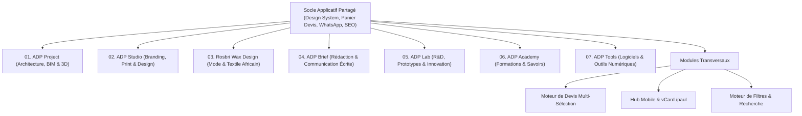
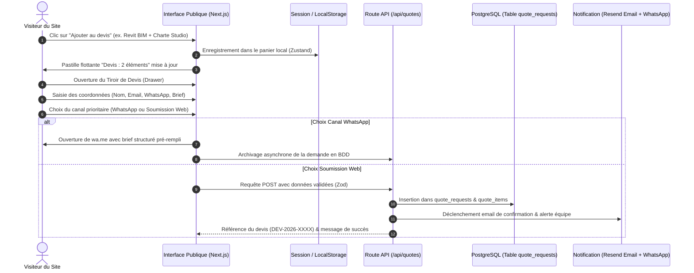

# ADP WEB EXPERIENCE — Rapport 03A-04 : Architecture des Modules Métiers et des Sept Univers

**Date :** 27 octobre 2026  
**Auteurs :** Architecte Logiciel Senior, Designer UX/UI, Expert Déontologie & Réglementation  
**Projet :** ADP WEB EXPERIENCE (`ateliersdepaul.com`)  
**Statut :** Spécification fonctionnelle et technique des modules — Étape 03A  

---

## 1. Vision Fonctionnelle des Modules Métiers

La plateforme **ADP WEB EXPERIENCE** structure l'ensemble de ses activités autour d'un socle modulaire unifié garantissant :
1. **Une identité commune :** Même expérience de navigation fluide, même qualité typographique, même possibilité d'ajouter des prestations au panier de devis.
2. **Une personnalisation poussée par univers :** Chaque pôle dispose de sa propre palette chromatique d'accent, de ses attributs techniques propres et de son vocabulaire visuel, administrables depuis le CMS sans modification de code source.
3. **Le respect des cadres réglementaires camerounais :** En particulier pour le pôle architectural (ADP Project).

---

## 2. Spécification Détaillée des Sept Univers

---

### Univers 01 — ADP Project
- **Intitulé public :** *ADP Project — Architecture · BIM · Visualisation 3D*
- **Couleur d'accent :** `#7DB9DC` (Bleu cyan architectural / ciel d'ingénierie)
- **Symbole géométrique :** `⌂` (Structure, édifice, compas)
- **Positionnement & Métier :** Conception architecturale, modélisation BIM (Building Information Modeling), plans d'exécution, rendus 3D photoréalistes, visites immersives et études techniques préparatoires.
- **Contrainte Déontologique & Légale Camerounaise (ONAC) :**
  - Conformément à la Loi n° 90/071 du 19 décembre 1990 régissant la profession d'architecte au Cameroun, la présentation des prestations doit distinguer rigoureusement :
    1. Les missions d'architecture réglementées (conception architecturale et suivi de chantier, assurées sous la signature d'un architecte régulièrement inscrit au tableau de l'Ordre National des Architectes du Cameroun - ONAC) ;
    2. Les prestations d'assistance technique et d'imagerie numérique (modélisation BIM, perspectives 3D, plans DAO/CAO sous mandat d'études).
  - Un encart légal permanent est intégré dans le composant d'en-tête de l'univers : *"Conception architecturale et études d'ingénierie conformes au cadre déontologique de l'ONAC"*.
- **Contenus hébergés :**
  - Galeries des 38 projets architecturaux issus de la migration legacy (avec fiches techniques : surface, ville, logiciel, typologie) ;
  - Visionneuse de plans et d'axonométries ;
  - Téléchargements de modèles 3D et familles Revit/SketchUp via le module `resources`.
- **Livrables types proposés au devis :**
  - Dossier de Permis de Construire (DPC) ;
  - Modèle BIM Revit / IFC coordonné ;
  - Perspectives extérieures 4K & Visites virtuelles animées.

---

### Univers 02 — ADP Studio
- **Intitulé public :** *ADP Studio — Design Graphique · Identité Visuelle · Print*
- **Couleur d'accent :** `#F3A66D` (Terre cuite dorée / ocre d'atelier graphique)
- **Symbole géométrique :** `✦` (Étoile à 4 branches, vecteur, créativité)
- **Positionnement & Métier :** Création d'identités de marque complètes, logotypes vectoriels, chartes graphiques d'entreprise, supports d'impression haut de gamme, signalétique intérieure et personnalisation d'objets.
- **Contenus hébergés :**
  - Portfolios de logos et typographies créées ;
  - Études de cas "Avant / Après" de refontes d'identités ;
  - Mockups photo-réalistes de papeterie, enseignes et packaging.
- **Livrables types proposés au devis :**
  - Charte d'identité visuelle complète (Logo SVG, palette, typographies) ;
  - Déclinaison de papeterie d'affaires (Cartes de visite, têtes de lettre, pochettes) ;
  - Kit de communication pour réseaux sociaux (Bannières, gabarits de publication).

---

### Univers 03 — Rosbri Wax Design
- **Intitulé public :** *Rosbri Wax Design — Mode Contemporaine · Textile Africain*
- **Couleur d'accent :** `#E68AB3` (Rose magenta poudré / garance textile)
- **Symbole géométrique :** `❋` (Motif floral textile, wax traditionnel)
- **Positionnement & Métier :** Haute confection et prêt-à-porter fusionnant l'art textile africain traditionnel (wax hollandais, batiks, kente) et des coupes modernes sur-mesure. Vêtements événementiels et collections capsules exclusives.
- **Contenus hébergés :**
  - Lookbooks de collections saisonnières (photos haute définition) ;
  - Fiches d'inspiration sur la symbolique des motifs et des tissus africains ;
  - Guide des mensurations et des finitions d'atelier.
- **Livrables types proposés au devis :**
  - Confection sur-mesure pour cérémonies ou réceptions ;
  - Création de séries personnalisées pour entreprises ou événements culturels ;
  - Accessoires exclusifs en tissu wax haut de gamme.

---

### Univers 04 — ADP Brief
- **Intitulé public :** *ADP Brief — Rédaction Stratégique · Contenus Éditoriaux*
- **Couleur d'accent :** `#B1CE9A` (Vert sauge / papier végétal d'édition)
- **Symbole géométrique :** `¶` (Pied-de-mouche typographique, structure textuelle)
- **Positionnement & Métier :** Conception de contenus rédactionnels de haut niveau pour les entreprises, les institutions et les projets de développement. Rédaction de dossiers de réponse à appels d'offres (bids), synthèses exécutives, manifestes d'entreprise et chartes éditoriales.
- **Contenus hébergés :**
  - Extraits d'études et de manifestes publiés ;
  - Guides méthodologiques pour la structuration d'un mémoire technique ;
  - Glossaires terminologiques sectoriels (architecture, urbanisme, technologie).
- **Livrables types proposés au devis :**
  - Dossier de mémoire technique et candidature à appel d'offres ;
  - Livre blanc institutionnel ou rapport annuel d'activité ;
  - Charte éditoriale et copywriting de site web corporate.

---

### Univers 05 — ADP Lab
- **Intitulé public :** *ADP Lab — Recherche · Expérimentation · Prototypes*
- **Couleur d'accent :** `#B8A0F4` (Violet améthyste / luminescence scientifique)
- **Symbole géométrique :** `⌬` (Structure moléculaire, réseau matriciel)
- **Positionnement & Métier :** Cellule de recherche appliquée explorant la conception générative, l'architecture bioclimatique adaptée au climat équatorial et tropical, l'impression 3D locale et les nouveaux matériaux durables.
- **Contenus hébergés :**
  - Journaux de recherche et notes de laboratoire ;
  - Démonstrations interactives de calculs d'ensoleillement et d'aération naturelle ;
  - Retours d'expérience sur l'usage de l'intelligence artificielle en modélisation spatiale.
- **Livrables types proposés au devis :**
  - Étude bioclimatique et simulation thermique préliminaire ;
  - Prototypage rapide et modélisation algorithmique paramétrique ;
  - Partenariats de recherche & développement.

---

### Univers 06 — ADP Academy
- **Intitulé public :** *ADP Academy — Formations · Pédagogie · Transmission*
- **Couleur d'accent :** `#E8C56F` (Or ambré / lumière de la connaissance)
- **Symbole géométrique :** `◇` (Diamant facetté, rigueur de l'apprentissage)
- **Positionnement & Métier :** Programmes de formation professionnelle et ateliers pratiques dédiés aux logiciels d'ingénierie et de conception (Revit BIM, SketchUp Pro, Enscape, Photoshop appliqué à l'architecture, gestion de chantier).
- **Contenus hébergés :**
  - Catalogues des cursus et fiches programmes téléchargeables (PDF) ;
  - Témoignages d'anciens apprenants et galeries de travaux réalisés en session ;
  - Calendrier des prochaines sessions de formation à Douala et à distance.
- **Livrables types proposés au devis :**
  - Inscription à une masterclass inter-entreprises ou session intensive ;
  - Programme de formation sur-mesure pour cabinet ou bureau d'études ;
  - Coaching individuel avancé sur flux BIM.

---

### Univers 07 — ADP Tools
- **Intitulé public :** *ADP Tools — Logiciels · Applications · Scripts d'Ingénierie*
- **Couleur d'accent :** `#7BDED8` (Turquoise numérique / flux de code)
- **Symbole géométrique :** `⚙` (Engrenage de précision, composant logiciel)
- **Positionnement & Métier :** Conception et distribution de micro-logiciels, scripts d'automatisation Revit/Dynamo, calculateurs métrés et gabarits de productivité pour les professionnels du bâtiment et de l'aménagement.
- **Contenus hébergés :**
  - Fiches de présentation des outils avec captures d'écran et vidéos de démonstration ;
  - Historique des versions (changelog) et documentation technique ;
  - Liens de téléchargement direct de versions d'essai et d'outils gratuits.
- **Livrables types proposés au devis :**
  - Développement de macros ou plugins personnalisés pour Revit / AutoCAD ;
  - Feuilles automatisées de métrés et devis quantitatifs estimatifs (DQE) ;
  - Licences d'utilisation d'outils numériques internes ADP.

---

## 3. Le Moteur de Panier de Devis Multi-Prestations (Quote Drawer)

L'une des innovations majeures de la plateforme consiste à permettre à un visiteur de composer sa demande d'accompagnement en sélectionnant plusieurs prestations issues d'univers différents.

### Caractéristiques ergonomiques du panier :
- **Persistance locale :** Le panier est conservé dans le navigateur du visiteur même s'il navigue entre les 7 univers ou ferme son onglet.
- **Zéro friction :** Aucun compte client requis pour composer ou envoyer la demande.
- **Routage intelligent :** La demande est automatiquement étiquetée avec les univers concernés pour faciliter le traitement dans ADP Control.

---

## 4. Carte de Visite Numérique `/paul` et vCard 3.0

La page `/paul` constitue un actif de terrain hautement stratégique pour Paul Boubert lors de ses rendez-vous professionnels à Douala, Yaoundé et dans la sous-région.

### Spécifications de la nouvelle version :
1. **URL pérenne :** `https://ateliersdepaul.com/paul` (Route dédiée ultra-légère).
2. **Génération dynamique du fichier vCard 3.0 :**
   - Téléchargement instantané d'un fichier `Paul_Boubert.vcf` normalisé UTF-8, contenant :
     - Nom complet, titre (*Architecte & Directeur Général*) ;
     - Numéros de téléphone directs (`tel:+237690715403`, WhatsApp `+237690087213`) ;
     - Email professionnel (`paul@ateliersdepaul.com`) ;
     - Adresse professionnelle et liens vers les 7 univers.
3. **QR Code vectoriel interactif :** Généré dynamiquement en SVG, permettant à un interlocuteur de scanner instantanément la fiche contact depuis un smartphone.
4. **Boutons d'action rapide (Quick Actions) :**
   - 📞 *Appeler immédiatement*
   - 💬 *Écrire sur WhatsApp*
   - ✉ *Envoyer un courriel*
   - ⬇ *Enregistrer dans les contacts du téléphone*
