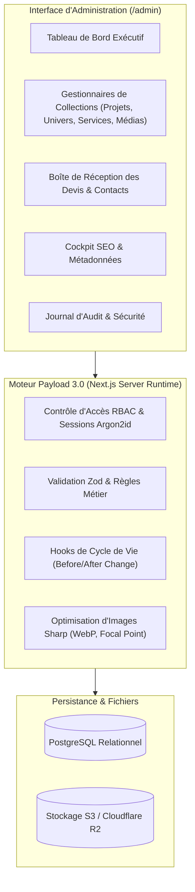
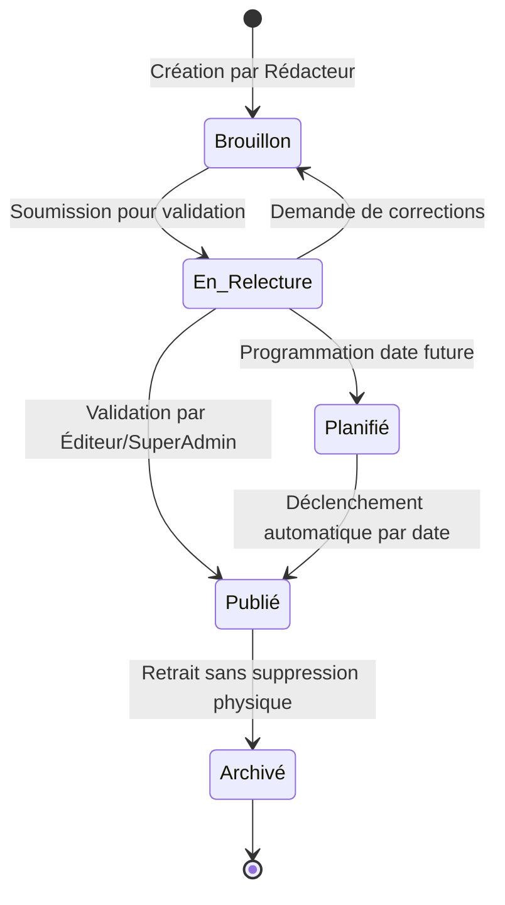

# ADP WEB EXPERIENCE — Rapport 03A-05 : Conception Détaillée d'ADP Control (CMS Headless)

**Date :** 27 octobre 2026  
**Auteurs :** Expert CMS Headless, Architecte Logiciel Senior, Designer UX/UI  
**Projet :** ADP WEB EXPERIENCE (`ateliersdepaul.com`)  
**Statut :** Spécification fonctionnelle et technique du back-office — Étape 03A  

---

## 1. Rôle et Ambition d'ADP Control

**ADP Control** est le centre névralgique de gestion de contenu et d'administration de la plateforme **ADP WEB EXPERIENCE**.

Il résout définitivement la dette technique majeure identifiée lors de l'audit 02B :
- Fin des modifications manuelles de code HTML pour changer une virgule ou un tarif ;
- Éradication des scripts regex de synchronisation (`sync-identities.cjs`) ;
- Centralisation de l'ensemble des contenus des 7 univers au sein d'une interface graphique moderne, sécurisée et intuitive, accessible depuis `https://ateliersdepaul.com/admin`.

---

## 2. Architecture Technique d'ADP Control

ADP Control est implémenté sous la forme d'un **panneau d'administration intégré propulsé par Payload CMS 3.0** au sein de l'application Next.js 15.

### Avantages clés de l'intégration native :
1. **Zéro latence inter-serveur :** Le back-office tourne sur le même serveur que le frontend, éliminant les pannes d'API distantes et les requêtes CORS complexes.
2. **Synchronisation temps réel :** La publication d'un contenu dans ADP Control purge immédiatement le cache de la page publique correspondante via le mécanisme de revalidation à la demande de Next.js (`revalidatePath()`).
3. **Prévisualisation en direct (Live Preview) :** Les rédacteurs visualisent les modifications en temps réel dans une fenêtre côte-à-côte avec le rendu réel du site.

---

## 3. Matrice de Sécurité et Rôles RBAC (Role-Based Access Control)

Quatre rôles d'utilisateurs internes sont configurés dans ADP Control pour garantir la gouvernance des données :

| Ressource / Module | SuperAdmin (Direction Paul) | Éditeur en Chef | Rédacteur / Designer | Commercial / Support |
|---|:---:|:---:|:---:|:---:|
| **Gestion des Utilisateurs & Rôles** | Lecture / Écriture / Suppression | Aucun accès | Aucun accès | Aucun accès |
| **Paramètres du Site & Possibility Machine** | Lecture / Écriture | Lecture seule | Aucun accès | Aucun accès |
| **7 Univers (Métadonnées & Thèmes)** | Lecture / Écriture | Lecture / Écriture | Lecture seule | Lecture seule |
| **38 Projets & Portfolios** | Contrôle total | Créer / Modifier / Publier | Créer / Modifier (Brouillon) | Lecture seule |
| **Services & Prestations** | Contrôle total | Créer / Modifier / Publier | Créer / Modifier (Brouillon) | Lecture seule |
| **Médiathèque (Upload & R2)** | Contrôle total | Upload / Organisation | Upload / Utilisation | Consultation seule |
| **Ressources (Modèles 3D)** | Contrôle total | Gestion complète | Ajout de fichiers | Téléchargement |
| **Demandes de Devis (Boîte de réception)** | Contrôle total | Lecture seule | Aucun accès | **Traitement / Changement statut** |
| **Contacts & Prospects (CRM)** | Contrôle total | Lecture seule | Aucun accès | **Lecture / Mise à jour notes** |
| **Newsletter (Abonnés)** | Contrôle total | Export CSV | Aucun accès | Lecture seule |
| **Réseaux Sociaux (Calendrier)** | Contrôle total | Planification / Validation | Rédaction brouillons | Lecture seule |
| **Journal d'Audit (Audit Logs)** | Lecture seule (Inaltérable) | Aucun accès | Aucun accès | Aucun accès |

---

## 4. Fonctionnalités Clés du Back-Office

### 4.1. Gestion du Cycle de Vie des Contenus (Workflow Éditorial)
Chaque document éditable (Projet, Service, Article, Page) traverse un cycle d'états rigoureux :

- **Sauvegarde automatique des versions :** Chaque modification enregistre un instantané (snapshot). Possibilité de comparer deux versions et de restaurer un état antérieur en un clic.
- **Programmation de publication :** Définition d'une date et heure futures pour la mise en ligne automatique d'un projet ou d'une actualité.

### 4.2. Médiathèque Intelligente Centralisée
Pour mettre fin au désordre des 739 fichiers médias du legacy :
- **Glisser-déposer universel :** Téléversement multiple avec barre de progression.
- **Conversion et compression automatique :** Toutes les images matricielles (JPG, PNG) sont instantanément converties en format moderne WebP optimisé via la bibliothèque serveur `sharp`.
- **Génération automatique des formats responsives :**
  - Miniature (Thumbnail) : 320x320 px
  - Vue liste (Card) : 800x600 px
  - Plein écran (Hero) : 1920x1080 px
- **Sélecteur de point focal (Focal Point Picker) :** L'administrateur clique sur le point d'intérêt de l'image (ex. le visage ou le détail architectural) pour garantir un cadrage parfait sur mobile comme sur grand écran.
- **Texte alternatif (Alt Text) obligatoire :** Impossible d'enregistrer un média sans renseigner sa description pour les lecteurs d'écran (a11y).
- **Détection des doublons et fichiers orphelins :** Indexation par empreinte cryptographique (hash MD5) empêchant de téléverser deux fois la même photo.

### 4.3. Boîte de Réception des Devis et Gestion des Contacts
- **Tableau de bord des devis entrants :** Affichage en temps réel avec pastille de notification pour chaque nouvelle demande soumise sur le site public.
- **Vue détaillée de la demande :**
  - Référence unique (`DEV-2026-XXXX`) ;
  - Coordonnées complètes du prospect (avec lien direct "Ouvrir WhatsApp" ou "Composer le numéro") ;
  - Intention de départ choisie sur l'accueil ;
  - Prestations et produits inclus dans le panier avec quantités et spécifications client ;
  - Historique des statuts : *En attente* ➔ *En cours d'étude* ➔ *Devis transmis* ➔ *Gagné* ➔ *Clôturé*.
- **Export instantané :** Téléchargement des demandes sélectionnées au format CSV ou PDF pour le chiffrage administratif.

### 4.4. Cockpit SEO & Référencement Intégré
- **Aperçu SERP Google en temps réel :** Visualisation exacte du titre, de l'URL et de la méta-description tels qu'ils apparaîtront dans les résultats du moteur de recherche.
- **Simulateur de partage social Open Graph :** Génération visuelle de la carte enrichie pour WhatsApp, LinkedIn, Facebook et Twitter/X, comblant définitivement la lacune des 18 images OG manquantes de l'ancien site.
- **Gestionnaire des 69 redirections 301 :** Interface dédiée pour ajouter, modifier ou désactiver des règles de redirection d'URL avec compteur d'utilisation en temps réel.

### 4.5. Traçabilité et Journal d'Audit
- Chaque action effectuée dans ADP Control (connexion, création de projet, modification de tarif, suppression de média) est inscrite de manière indélébile dans la collection `audit_logs`.
- Enregistrement de l'identifiant de l'auteur, de l'horodatage précis à la milliseconde, de l'adresse IP et du diff JSON exact des champs altérés.
