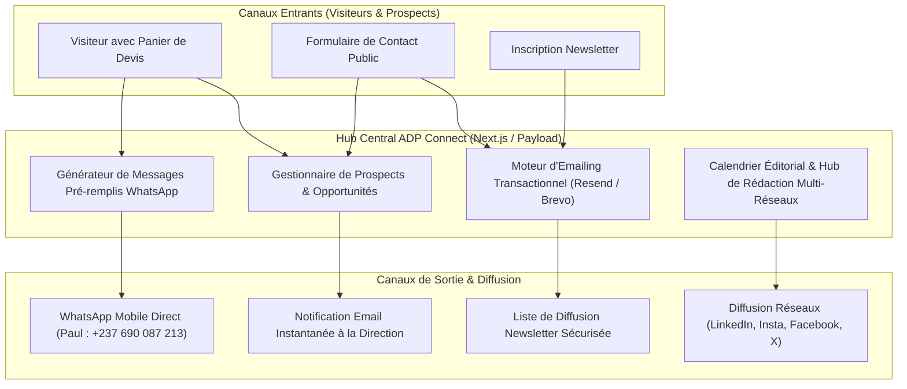

# ADP WEB EXPERIENCE — Rapport 03A-06 : Conception d'ADP Connect (Hub de Communication & Réseaux)

**Date :** 27 octobre 2026  
**Auteurs :** Architecte Intégrations & Automatisations, Spécialiste Marketing & Conversion, Expert Cybersécurité  
**Projet :** ADP WEB EXPERIENCE (`ateliersdepaul.com`)  
**Statut :** Spécification fonctionnelle et technique d'ADP Connect — Étape 03A  

---

## 1. Vision et Objectifs d'ADP Connect

**ADP Connect** constitue le pôle opérationnel de communication externe des **Ateliers de Paul**.

Sa mission est de synchroniser en un point unique la diffusion des savoir-faire, le suivi des opportunités commerciales et le dialogue direct avec les prospects au Cameroun et à l'international.

### Règle d'or de réalisme technique :
Contrairement aux promesses irréalistes de "publication automatique universelle en un clic", le comité technique pose un cadre d'ingénierie rigoureux distinguant strictement :
1. **Ce qui est opérationnel immédiatement dès le lancement (MVP) ;**
2. **Ce qui nécessite une API officielle et des identifiants professionnels ;**
3. **Ce qui dépend d'autorisations strictes imposées par les plateformes tierces.**

---

## 2. Matrice de Réalisme Technique des Canaux de Communication

| Canal / Fonctionnalité | Niveau de Disponibilité | Prérequis Techniques | Contraintes & Restrictions des Plateformes Tierces |
|---|:---:|---|---|
| **1. WhatsApp Direct (Click-to-Chat)** | **Immédiat (MVP)** | URL standard `wa.me` avec texte pré-encodé | Aucune restriction, fonctionne sur 100% des smartphones sans compte développeur. |
| **2. Suivi des Devis & Prospects (CRM)** | **Immédiat (MVP)** | Base de données PostgreSQL locale | Données 100% souveraines hébergées dans la plateforme ADP. |
| **3. Inscription Newsletter (Double Opt-in)** | **Immédiat (MVP)** | Clé API Resend ou Brevo | Vérification DNS du domaine (`SPF`, `DKIM`, `DMARC`) pour éviter les spams. |
| **4. Calendrier Éditorial Centralisé** | **Immédiat (MVP)** | Table BDD `social_posts` | Planification interne, sans dépendance réseau externe. |
| **5. Hub 1 Sujet ➔ 6 Formats Sociaux** | **Immédiat (MVP)** | Module React ADP Connect | Génère le texte adapté pour chaque réseau avec bouton "Copier le texte" et lien d'ouverture directe. |
| **6. Envoi de Campagnes Newsletter en masse** | *Phase 2 (API)* | Fournisseur Emailing (Brevo/Resend) | Nécessite un forfait d'envoi adapté au volume d'abonnés. |
| **7. Publication Automatique LinkedIn** | *Phase 2 (API)* | LinkedIn Community Management API | Nécessite un compte LinkedIn Developer, une Page Entreprise vérifiée et l'obtention du scope `w_member_social` / `w_organization_social`. |
| **8. Publication Automatique Facebook & Instagram** | *Phase 2 (API)* | Meta Graph API (Instagram Graph API) | Compte Instagram Professionnel relié à une Page Facebook, vérification d'entreprise Meta Business requise, tokens OAuth valides 60 jours. |
| **9. Publication Automatique X (Twitter)** | *Phase 3 (Optionnel)* | X Developer API | Accès API payant très restrictif (plan de base à 100 $/mois non justifié au lancement). |
| **10. Publication Automatique TikTok** | *Phase 3 (Optionnel)* | TikTok Content Posting API | Processus d'audit d'application contraignant, réservé aux applications grand public certifiées. |
| **11. WhatsApp Cloud API (Messagerie 2 sens)** | *Phase 3 (API)* | Meta WhatsApp Cloud API | Nécessite un numéro de téléphone dédié non associé à un compte WhatsApp personnel, et validation d'entreprise Meta. |

---

## 3. Architecture Fonctionnelle du Hub ADP Connect



---

## 4. Spécification Détaillée des Modules Opérationnels

### 4.1. Le Canal Prioritaire WhatsApp (Click-to-Chat Intelligent)
Au Cameroun et en Afrique centrale, WhatsApp est le canal d'affaires prédominant. L'expérience doit être fluide et immédiate :
- **Mécanisme :**
  Lorsqu'un visiteur compose un devis ou souhaite contacter l'atelier, un bouton proéminent *"Transmettre via WhatsApp"* construit dynamiquement une URL sécurisée vers le numéro officiel `+237690087213`.
- **Génération dynamique du message structuré :**
  Le message envoyé est automatiquement mis en forme avec une structure claire et professionnelle :
  ```text
  Bonjour Paul et l'équipe ADP,
  
  Je vous contacte depuis ateliersdepaul.com au sujet d'un projet :
  • Intention : Concevoir un espace
  • Prestations sélectionnées : 
    - Dossier de Permis de Construire (ADP Project)
    - Modélisation BIM 3D (ADP Project)
  • Référence devis : DEV-202610-0482
  
  Mes coordonnées :
  • Nom : Jean Dupont
  • Email : jean.dupont@entreprise.cm
  • Ville : Douala
  
  Brève description :
  "Projet d'immeuble R+4 à Bonapriso, besoin d'un chiffrage sous 10 jours."
  ```
- **Avantage immédiat :** Zéro friction technique, pas de blocage par les spams email, ouverture instantanée de l'application WhatsApp du prospect avec le message prêt à être envoyé.

---

### 4.2. Le Pipeline Commercial et CRM Intégré
Toutes les demandes issues du site public (panier de devis, formulaire de contact, inscription directe) sont automatiquement consolidées dans la table `contacts` et `quote_requests` :
1. **Élimination définitive de l'exposition Web3Forms :**
   - L'ancienne clé API publique exposée dans le HTML est supprimée.
   - La soumission s'effectue vers une route API serveur interne (`/api/contact` ou `/api/quotes`) qui valide les données avec Zod, applique un limiteur de débit (rate limiter) et vérifie un champ invisible anti-spam (honeypot).
2. **Statuts de traitement visuels :**
   - 🔵 **Nouveau :** Demande reçue, non traitée.
   - 🟡 **En cours d'étude :** Paul ou un collaborateur a pris en charge le dossier.
   - 🟣 **Devis transmis :** Proposition chiffrée envoyée au client.
   - 🟢 **Gagné / En production :** Mission acceptée et contractualisée.
   - ⚪ **Clôturé / Sans suite :** Archivé avec motif.
3. **Historique des interactions :**
   - Zone de notes internes permettant d'ajouter des comptes-rendus d'appels ou des spécifications techniques complémentaires.

---

### 4.3. Gestionnaire de Newsletter et Conformité Légale
Le formulaire de newsletter du site historique ne comportait ni stockage ni respect des règles d'opt-in. ADP Connect corrige cette faiblesse :
1. **Processus de Double Opt-in rigoureux :**
   - Étape 1 : Le visiteur saisit son adresse email dans le composant footer.
   - Étape 2 : Un email de confirmation lui est adressé avec un jeton sécurisé unique valable 48 heures.
   - Étape 3 : Le clic sur le lien valide l'adresse dans la table `newsletter_subscribers` avec horodatage et preuve de consentement.
2. **Désabonnement en un clic (Unsubscribe) :**
   - Chaque communication future intègre un lien cryptographique de désinscription directe conformément à la réglementation.
3. **Synchronisation API :**
   - Connexion via webhook à la plateforme de routage (Resend ou Brevo) pour gérer les désabonnements sans intervention manuelle.

---

### 4.4. Hub Éditorial des Réseaux Sociaux (1 Sujet ➔ 6 Canaux)
Ce module remplace et pérennise l'ébauche locale trouvée dans le dossier `POST/` du legacy :
- **Principe :** Un sujet phare (ex. *"Livraison du projet Bafoussam"* ou *"Nouvelle capsule Rosbri"*) est saisi une seule fois dans ADP Connect.
- **Déclinaison intelligente par plateforme :**
  - **LinkedIn :** Ton analytique, axé sur les défis techniques d'ingénierie, les partenaires et les retours d'expérience.
  - **Instagram :** Accroche courte, storytelling émotionnel, liste ordonnée de hashtags, référence au lien dans la bio (`/paul`).
  - **Facebook :** Ton chaleureux et engageant pour la communauté locale au Cameroun.
  - **X (Twitter) :** Version incisive limitée strictement à 280 caractères avec visuel attaché.
  - **WhatsApp Status / Broadcast :** Texte court avec émoticônes claires et appel à l'action direct.
  - **Site Web (Section Créations / Actualités) :** Réinjection automatique de l'article sur la page d'accueil ou dans l'univers correspondant.
- **Mode d'exploitation au lancement (MVP) :**
  - Calendrier visuel mensuel avec code couleur par univers ;
  - Prévisualisation instantanée du rendu sur chaque réseau ;
  - Bouton *"Copier pour LinkedIn"*, *"Copier pour Instagram"* et ouverture de la page officielle du réseau social dans un onglet dédié.
  - Ce mode pragmatique permet une utilisation immédiate sans attendre les autorisations complexes des API des plateformes.

---

## 5. Statistiques et Indicateurs de Performance (KPIs)

Le tableau de bord d'ADP Connect suit 4 indicateurs fondamentaux sans recourir à des cookies traceurs intrusifs :
1. **Volume de demandes entrantes par univers :** Répartition des devis (architecture, design, textile, formation).
2. **Taux de conversion des intentions :** Analyse des intentions de la *Possibility Machine* qui débouchent le plus fréquemment sur une prise de contact.
3. **Performance des canaux de contact :** Ratio des demandes transmises par WhatsApp vs par formulaire web.
4. **Croissance de l'audience :** Nombre d'abonnés actifs à la newsletter et consultations de la page vCard `/paul`.
