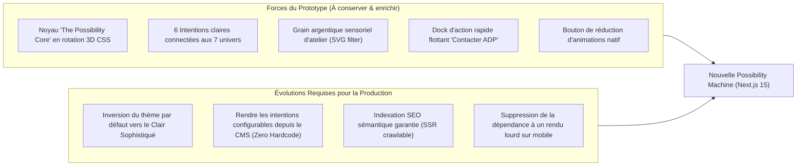
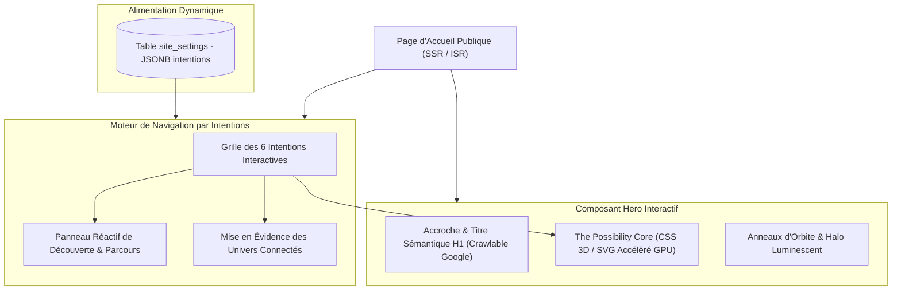

# ADP WEB EXPERIENCE — Rapport 03A-07 : Ingénierie de l'Expérience « The Possibility Machine »

**Date :** 27 octobre 2026  
**Auteurs :** Designer UX/UI, Expert Next.js / React, Expert Accessibilité (a11y), Expert SEO  
**Projet :** ADP WEB EXPERIENCE (`ateliersdepaul.com`)  
**Statut :** Spécification technique et scénographie interactive — Étape 03A  

---

## 1. Concept Créatif et Direction Artistique

Le concept créatif **THE POSSIBILITY MACHINE** incarne la métamorphose de l'atelier d'architecture traditionnel en un laboratoire vivant de création et d'ingénierie pluridisciplinaire.

- **Signature de marque :** *Une idée. Mille possibilités.*
- **Direction artistique :** *Fusion Atelier vivant + Matière en mouvement*.
- **Posture Visuelle & Colorimétrie :**
  - **Thème Clair Minéral Sophistiqué (Par Défaut) :** 
    - Fond principal pierre d'atelier et ivoire naturel (`#F9F8F5`) ;
    - Surfaces secondaires en lin texturé et blanc albâtre (`#FFFFFF`, `#F0EFEA`) ;
    - Accents métalliques d'atelier : bronze patiné, laiton brossé et acier chaud (`#C59B53`, `#8A6731`) ;
    - Typographie de titrage en ardoise profonde (`#1A222D`) offrant un contraste WCAG AAA supérieur à 12:1 ;
    - Lignes de division d'une extrême finesse (`#1A222D15`).
  - **Mode Sombre d'Atelier (Optionnel & Non Imposé) :**
    - Activé via bascule utilisateur ou respect du paramètre système `prefers-color-scheme: dark` ;
    - Fond nuit bleu-ardoise d'atelier (`#0C1422`), panneaux graphite (`#17253A`), textes blanc ivoire (`#F7F4ED`), et accents or chaud (`#E9BD7A`).

---

## 2. Analyse Critique du Prototype HTML Existant

L'analyse du prototype [ADP_Possibility_Machine_Prototype.html](file:///d:/05_ADP_SOFTWARE/00_ADP%20WEB%20EXPERIENCE/ADP_Possibility_Machine_Prototype.html) révèle des fondations solides et des axes de perfectionnement majeurs :



---

## 3. Architecture Technique de la « Possibility Machine »

L'expérience interactive de l'accueil se décompose en 4 composants majeurs :



---

## 4. Spécification Détaillée des Composants

### 4.1. The Possibility Core (Noyau Interactif 3D)
Au lieu d'imposer une bibliothèque 3D lourde (Three.js ou Babylon.js nécessitant 600 Ko de bundle et consommant la batterie des smartphones), **le noyau est conçu en pure accélération matérielle CSS 3D Transforms et SVG vectoriel** :
- **Géométrie :**
  - Trois prismes géométriques imbriqués utilisant des découpes polygonales (`clip-path: polygon(50% 0, 92% 24%, 92% 74%, 50% 100%, 8% 74%, 8% 24%)`) évoquant le cristal minéral et le facettage d'architecte ;
  - Deux anneaux concentriques en rotation inverse créant l'illusion d'une sphère armillaire ou d'un gyroscope d'ingénieur ;
  - Halo radial lumineux réagissant à la couleur d'accent de l'intention active.
- **Réactivité cinétique :**
  - Au survol ou au changement d'intention, la vitesse de rotation accélère délicatement et l'axe d'inclinaison s'adapte via la propriété `transform: rotate3d(...)` ;
  - Sur mobile, les dimensions sont adaptées automatiquement (passage de 260 px à 170 px) sans aucune dégradation de fluidité (60 fps constants).

---

### 4.2. Le Moteur de Navigation par Intentions
Le visiteur ne commence pas sa visite par un organigramme d'entreprise froid, mais par ce qu'il souhaite accomplir :

#### Matrice des Intentions par Défaut (Configurable depuis ADP Control) :

| N° | Intention Visiteur | Résumé du Parcours | Univers Connectés Activés | Couleur d'Accent Réactive |
|:---:|---|---|---|:---:|
| **01** | **Concevoir un espace** | Plans techniques, maquette BIM, 3D photoréaliste et accompagnement architectural. | **ADP Project** | `#7DB9DC` (Bleu architecture) |
| **02** | **Créer une identité** | Image de marque, logo vectoriel, charte d'entreprise et supports imprimés. | **ADP Studio**, **ADP Brief** | `#F3A66D` (Terre d'ocre) |
| **03** | **Personnaliser un produit** | Objets promotionnels d'affaires ou créations textiles africaines exclusives. | **ADP Studio**, **Rosbri Wax Design** | `#E68AB3` (Rose garance) |
| **04** | **Apprendre et transmettre** | Formations professionnelles Revit/BIM, masterclasses et ressources pédagogiques. | **ADP Academy**, **ADP Brief** | `#E8C56F` (Or ambré) |
| **05** | **Expérimenter et innover** | Études bioclimatiques, prototypage rapide et nouveaux outils numériques. | **ADP Lab**, **ADP Tools** | `#B8A0F4` (Améthyste) |
| **06** | **Explorer toutes les possibilités** | Immersion totale au cœur des sept ateliers interconnectés. | **Les 7 Univers Réunis** | `#C59B53` (Laiton patiné) |

#### Mécanisme de personnalisation sans modification de code :
- Les libellés, descriptions et univers associés sont stockés dans le champ JSONB `possibility_machine_intentions` de la table `site_settings` dans PostgreSQL ;
- Paul Boubert peut ainsi renommer une intention, réagencer l'ordre ou modifier les univers suggérés directement depuis l'interface d'ADP Control.

---

### 4.3. Gestion du Mode Réduit en Animations et Accessibilité
L'accessibilité n'est pas une option rapportée, mais un pilier de la conception :
1. **Prise en compte native de `prefers-reduced-motion: reduce` :**
   - Lorsque le système d'exploitation du visiteur signale une préférence pour les mouvements réduits, les animations CSS de rotation et de lévitation s'arrêtent instantanément (`animation: none !important`) ;
   - Le noyau s'affiche sous la forme d'une gravure géométrique noble et statique ;
   - Les transitions de défilement deviennent instantanées (`scroll-behavior: auto`).
2. **Bouton de contrôle direct dans l'interface :**
   - Un bouton discret `◌ Réduire les animations` est accessible dans le pied de page et l'en-tête pour permettre à tout utilisateur de désactiver les mouvements à tout instant.
3. **Maintien absolu du curseur système :**
   - Contrairement au legacy qui forçait `* { cursor: none }`, le curseur natif du système d'exploitation est conservé dans toute l'application. Les survols sont signalés par des micro-variations de bordures et d'élévations ombrées douces.
4. **Navigation clavier intégrale :**
   - Toutes les intentions sont des éléments `<button>` natifs munis d'attributs `aria-controls` et de bagues de focus visibles (`outline: 2px solid var(--accent)`).
   - Les changements de contenu dynamique sont annoncés aux technologies d'assistance via la zone `aria-live="polite"`.

---

### 4.4. Sanctuarisation du Référencement Naturel (SEO) de l'Accueil
Pour garantir un positionnement de premier plan sur Google pour les requêtes camerounaises et internationales (*"architecte Douala", "BIM Cameroun", "design identité Afrique"*), la Possibility Machine respecte une hiérarchie HTML stricte :
- **Un seul titre `<h1>` sémantique dans le Hero :**
  ```html
  <h1>Et si vos idées <em>prenaient vie au Cameroun et au-delà ?</em></h1>
  ```
- **Texte d'introduction descriptif indexable :**
  Tous les textes des intentions et les descriptions des 7 univers sont présents dans le code source HTML initial retourné par le serveur Next.js (SSR), et non injectés tardivement par JavaScript.
- **Données structurées JSON-LD :**
  Le schéma `ProfessionalService` d'ADP est injecté en tête de document avec géolocalisation précise à Douala, horaires et catalogue de compétences.
