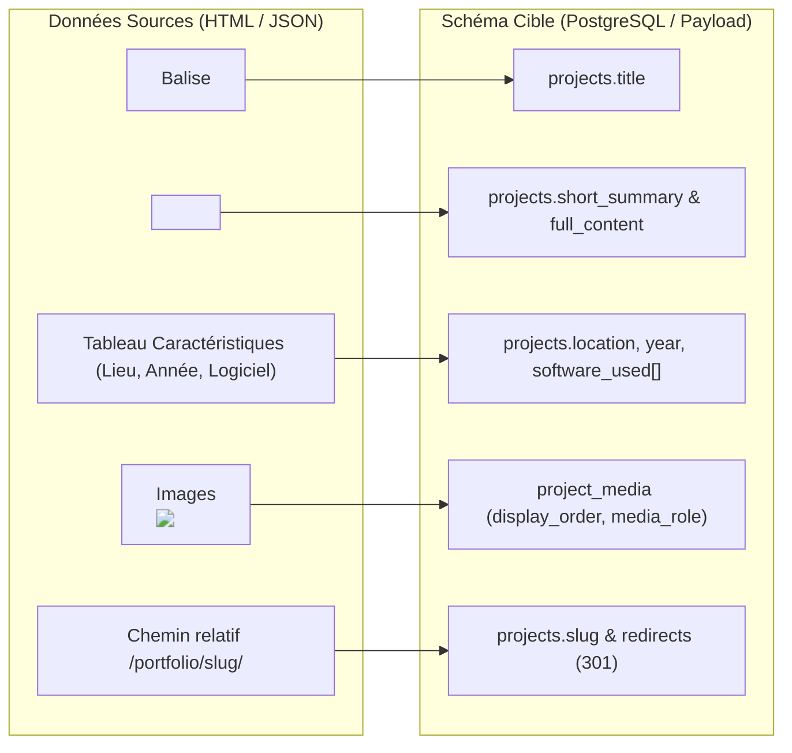
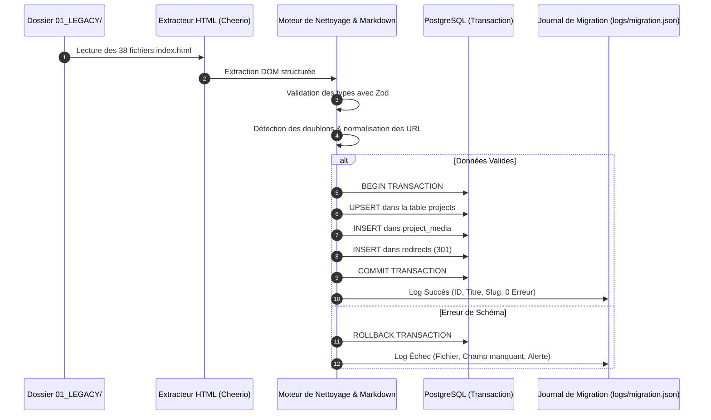
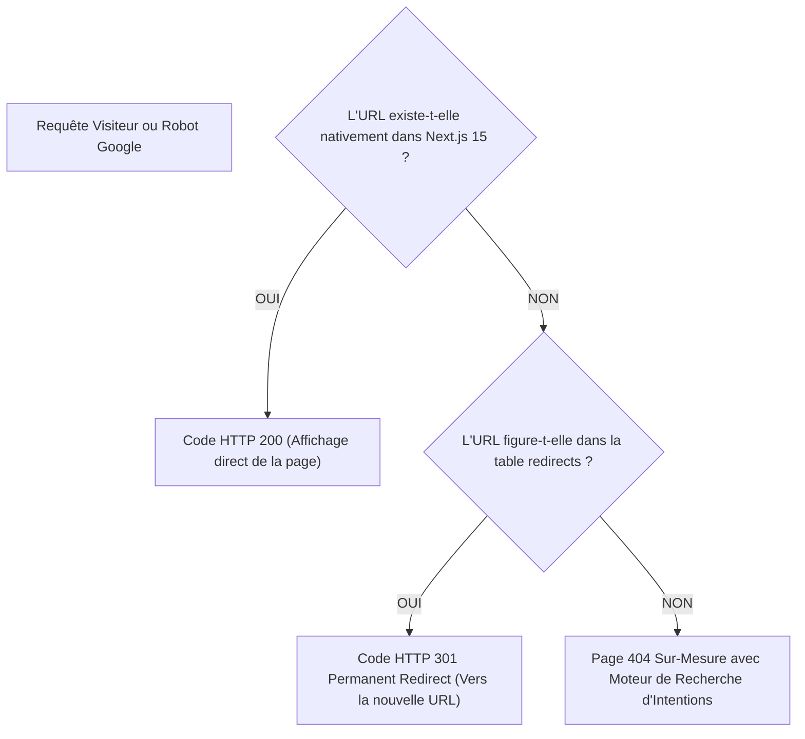

# ADP WEB EXPERIENCE — Rapport 03A-08 : Stratégie de Migration des Données et Actifs Legacy

**Date :** 27 octobre 2026  
**Auteurs :** Architecte Logiciel Senior, Architecte de Bases de Données PostgreSQL, Responsable QA  
**Projet :** ADP WEB EXPERIENCE (`ateliersdepaul.com`)  
**Statut :** Plan d'ingénierie de migration et matrice de correspondance — Étape 03A  

---

## 1. Périmètre et Inventaire Vérifié des Données Sources

L'audit approfondi conduit sur le dossier `01_LEGACY/paul-boubert-portfolio/` a permis de recenser avec exactitude les actifs de contenu à transférer vers la nouvelle plateforme :

| Actif Legacy | Quantité Vérifiée | Format Source | Destination Cible dans PostgreSQL |
|---|:---:|---|---|
| **Projets d'architecture & portfolio** | **38 projets** | 38 dossiers dans `portfolio/*/index.html` | Table `projects` & `project_media` |
| **Pôles et identités de marque** | **7 univers** | Pages dédiées (`adp-project`, `studio`, etc.) | Table `universes` |
| **Catalogue de modèles 3D** | **802 modèles** | Fichier `sketchup-models.json` (51 Ko) | Table `resources` & `categories` |
| **Carte de visite & contact direct** | **1 vCard + 1 page** | `paul/index.html` + `Paul_Boubert.vcf` | Route `/paul` + Table `site_settings` |
| **Identités vectorielles & logos** | **7 logos + 4 SVG** | `assets/identities/*.webp` + SVG locaux | Table `media` (Cloudflare R2) |
| **Règles de redirection historiques** | **69 URL canoniques** | `vercel.json` + `sitemap.xml` | Table `redirects` |
| **Fiches déontologiques & mentions** | **3 pages** | `cadre-deontologique/`, `mentions-legales/` | Table `pages` |

*Rappel de conformité Étape 03A : Aucun fichier média n'est téléchargé pendant cette phase de conception.*

---

## 2. Matrice de Correspondance des Données (Mapping Champs Anciens ➔ Nouveaux)

### 2.1. Mapping Détaillé pour la Collection `projects`

| Champ Legacy (HTML du Portfolio) | Type Source | Champ Cible PostgreSQL | Type Cible | Règle de Transformation & Validation |
|---|---|---|---|---|
| `<h1>` ou `header .title` | `String` | `projects.title` | `VARCHAR(255)` | Nettoyage des espaces insécables et entités HTML. |
| Nom du sous-dossier (ex. `bicec_bafoussam`) | `String` | `projects.slug` | `VARCHAR(255)` | Slugifié en minuscules, regex `^[a-z0-9_-]+$`. |
| Chemin relatif historique | `String` | `projects.legacy_url` | `VARCHAR(255)` | Enregistré pour alimenter automatiquement la table `redirects`. |
| Balise `` | `String` | `projects.location` | `VARCHAR(200)` | Normalisation ex. *"Bafoussam, Cameroun"*. |
| Balise `` | `String` | `projects.year` | `INT` | Extraction regex `\b(20\d{2})\b`. |
| Balise `` | `String` | `projects.surface_area` | `VARCHAR(100)` | Nettoyage unité (m²). |
| Liste des badges logiciels | `String[]` | `projects.software_used` | `TEXT[]` | Découpage en tableau (ex. `['Revit', 'Enscape']`). |
| Paragraphes de présentation | `HTML` | `projects.full_content` | `TEXT` | Conversion HTML ➔ Markdown épuré via Turndown. |
| Première image de couverture | `File path` | `projects.cover_image_id` | `UUID` | Liaison vers la ressource migrée dans `media`. |
| Ordre d'affichage dans la grille | `Index` | `projects.order` | `INT` | Préservation de l'ordonnancement éditorial initial. |

---

### 2.2. Mapping pour les 802 Modèles 3D (`sketchup-models.json`)

| Propriété JSON Legacy | Champ Cible `resources` | Type Cible | Règle de Traitement |
|---|---|---|---|
| `"name"` | `title` | `VARCHAR(255)` | Titre du modèle (ex. *"Fauteuil Lounge Contemporain"*). |
| `"category"` | `category_id` | `UUID` | Création / déduplication automatique dans la table `categories`. |
| `"url"` (Lien Google Drive) | `external_download_url` | `VARCHAR(500)` | Préservation du lien de téléchargement direct vérifié. |
| `"thumb"` (Vignette distante) | `thumbnail_url` | `VARCHAR(500)` | Stockage de l'URL source pour archivage propre. |
| `"format"` (par défaut .skp) | `file_format` | `VARCHAR(20)` | Valeur forcée `'.skp'`. |
| — (Génération système) | `resource_type` | `ENUM` | Valeur `'sketchup_3d'`. |
| — (Liaison univers) | `universe_id` | `UUID` | Rattaché par défaut à l'univers **ADP Project**. |

---

## 3. Pipeline ETL Automatisé (Extract - Transform - Load)

Le processus d'ingestion s'exécute via un script Node.js / TypeScript souverain (`scripts/migrate-legacy.ts`) sans outil opaque tiers :

### 3.1. Règles d'Idempotence et Reprise Après Échec
- **Principe d'Upsert :** Chaque enregistrement est identifié par sa clé d'unicité naturelle (`slug` pour les projets, `s3_key` pour les médias, `email` pour les contacts).
- **Relance sans risque :** Si le script s'interrompt à l'élément n°24 sur 38 suite à une coupure, une nouvelle exécution met à jour les 23 premiers sans créer aucun doublon et reprend là où il s'était arrêté.
- **Transactions Atomiques :** L'insertion d'un projet et de ses photos associées est encapsulée dans une transaction PostgreSQL unique : soit tout est importé avec succès, soit rien n'est injecté (`ROLLBACK`).

---

## 4. Stratégie de Préservation des 69 URL et Continuité SEO

Pour éviter toute déperdition de trafic ou pénalité algorithmique de Google, **aucune URL historique ne doit renvoyer de code d'erreur 404** :

### Cartographie des Redirections Majeures :

| URL Historique Legacy | Statut HTTP Cible | Destination Nouvelle Application | Justification SEO |
|---|:---:|---|---|
| `https://ateliersdepaul.com/` | **200 OK** | `/` (Accueil The Possibility Machine) | Page maîtresse |
| `/portfolio` | **200 OK** | `/portfolio` (Galerie unifiée des 38 projets) | Maintien du slug |
| `/portfolio/bicec` | **301 Permanent** | `/portfolio/bicec_bafoussam` | Correction historique |
| `/projects/:slug` | **301 Permanent** | `/portfolio/:slug` | Règle wildcard de vercel.json |
| `/about` ou `/about.html` | **301 Permanent** | `/a-propos` | Canonicalisation française |
| `/paul` | **200 OK** | `/paul` (vCard numérique moderne) | Préservation absolue |
| `/ressources` | **200 OK** | `/ressources` (Catalogue 3D & Téléchargements) | Maintien du slug |
| `/adp-project`, `/adp-studio` | **200 OK** | `/adp-project`, `/adp-studio` | Pages des 7 univers |
| `/apd-flow` (Faute de frappe legacy) | **301 Permanent** | `/adp-project` | Correction de l'erreur d'audit |
