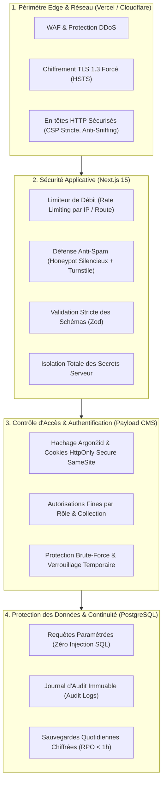

# ADP WEB EXPERIENCE — Rapport 03A-09 : Sécurité, Conformité Légale et Stratégie DevOps

**Date :** 27 octobre 2026  
**Auteurs :** Ingénieur Cybersécurité, Responsable DevOps, Architecte Logiciel Senior  
**Projet :** ADP WEB EXPERIENCE (`ateliersdepaul.com`)  
**Statut :** Spécification technique de sécurité et d'infrastructure — Étape 03A  

---

## 1. Principes Directeurs de Cybersécurité

La plateforme **ADP WEB EXPERIENCE** adopte le principe de **défense en profondeur (Defense in Depth)** et l'approche **Zero Trust**.

L'audit 02B ayant mis en évidence des vulnérabilités critiques dans l'ancien site (exposition publique de la clé API Web3Forms, absence d'en-tête CSP et HSTS, absence totale d'authentification), la nouvelle architecture verrouille chaque couche de l'application :



---

## 2. Authentification et Protection des Accès

### 2.1. Hachage des Mots de Passe & Gestion des Sessions
- **Algorithme de hachage :** **Argon2id** (recommandation OWASP 2026), avec sel aléatoire unique par utilisateur. Aucun mot de passe en clair ou faiblement haché (MD5/SHA1) n'est toléré.
- **Gestion des sessions :**
  - Jeton de session chiffré stocké exclusivement dans un cookie sécurisé :
    - `HttpOnly` : Inaccessible aux scripts JavaScript du navigateur (immunité contre les vols de session par injection XSS) ;
    - `Secure` : Transmis uniquement sur les connexions HTTPS ;
    - `SameSite=Strict` : Protection native contre les attaques CSRF (Cross-Site Request Forgery).
  - Durée de vie de la session : 7 jours d'inactivité avec renouvellement glissant.

### 2.2. Défense Contre les Attaques par Force Brute
- Limitation stricte sur la route de connexion `/admin/login` :
  - Maximum 5 tentatives de mot de passe erronées par adresse IP dans une fenêtre de 15 minutes ;
  - Au-delà de 5 échecs : verrouillage automatique du compte pendant 30 minutes et notification de sécurité par email à l'administrateur ;
  - Temporisation exponentielle artificielle (delay) entre chaque essai pour décourager les robots d'attaque.

---

## 3. Sécurisation des Flux Applicatifs et des Formulaires

### 3.1. Éradication Définitive des Clés API Exposées
- **Constat d'audit :** L'ancien site exposait la clé `d4c50b39-bbfc-42c4-a02f-8cfe7f03b507` en clair dans le code client.
- **Solution cible :**
  - Aucune clé secrète (base de données, Cloudflare R2, Resend, WhatsApp) ne porte le préfixe `NEXT_PUBLIC_` ;
  - Toutes les requêtes sensibles transitent par des Server Actions ou des routes API internes Next.js côté serveur (`/api/contact`, `/api/quotes`) qui opèrent hors de portée du navigateur.

### 3.2. Validation des Entrées et Protection Anti-Spam
- **Validation Zod intégrale :** Chaque payload reçu est strictement validé avant traitement (longueur minimale/maximale, formats d'emails, filtrage des caractères de contrôle).
- **Piège à robots silencieux (Honeypot) :** Un champ de saisie invisible pour les humains (`website_url` ou `b_hp_check`) est présent dans les formulaires. Si ce champ est rempli (comportement typique des bots automatisés), la soumission est silencieusement ignorée avec un faux code de succès 200, sans consommer de ressource serveur.
- **Validation anti-bot Cloudflare Turnstile (Optionnelle / Activée en cas d'attaque) :** Défi invisible sans puzzle rébarbatif pour l'utilisateur.

---

## 4. Configuration des En-têtes HTTP de Sécurité

La configuration de production injecte systématiquement les en-têtes HTTP stricts via le middleware Next.js :

```http
Strict-Transport-Security: max-age=63072000; includeSubDomains; preload
X-Content-Type-Options: nosniff
X-Frame-Options: SAMEORIGIN
Referrer-Policy: strict-origin-when-cross-origin
Permissions-Policy: camera=(), microphone=(), geolocation=(), browsing-topics=()
Content-Security-Policy: default-src 'self'; script-src 'self' 'unsafe-inline' https://challenges.cloudflare.com; style-src 'self' 'unsafe-inline' https://fonts.googleapis.com; font-src 'self' https://fonts.gstatic.com data:; img-src 'self' data: blob: https://*.r2.cloudflarestorage.com https://cdn.ateliersdepaul.com; connect-src 'self' https://api.resend.com; frame-ancestors 'self';
```

---

## 5. Conformité Légale et Protection des Données Personnelles

Le traitement des données à caractère personnel collectées sur `ateliersdepaul.com` respecte un double cadre juridique :

### 5.1. Réglementation Nationale Camerounaise
- **Loi n° 2010/012 du 21 décembre 2010 relative à la cybersécurité et la cybercriminalité au Cameroun :**
  - Obligation de sécurisation des données collectées (Article 42) ;
  - Confidentialité stricte des échanges commerciaux et des identités des clients ;
  - Traçabilité des accès aux systèmes d'information assurée par la table `audit_logs`.

### 5.2. Standards Internationaux de Confidentialité (RGPD / Données Personnelles)
- **Minimisation des données :** Seules les informations strictement nécessaires à l'établissement du devis (Nom, Email, WhatsApp, Ville, Description) sont requises.
- **Pas de traceurs tiers invasifs au lancement :** Suppression des scripts publicitaires invasifs. L'analyse d'audience s'effectue sans dépôt de cookies nécessitant un bandeau intrusif.
- **Droit d'accès et d'effacement :** Tout utilisateur peut solliciter la purge de sa fiche de contact en écrivant à `paul@ateliersdepaul.com`. La suppression logique (`deleted_at`) est immédiate et la purge physique automatisée sous 30 jours.

---

## 6. Stratégie de Sauvegarde, Restauration et Reprise d'Activité (PCA/PRA)

| Composant | Stratégie de Sauvegarde | RPO (Perte max tolérée) | RTO (Temps de rétablissement) |
|---|---|:---:|:---:|
| **Base de Données PostgreSQL** | Snapshot automatique quotidien + WAL continus (Point-in-Time Recovery sur 7 jours) | **< 1 heure** | **< 30 minutes** |
| **Médias & Objets (Cloudflare R2)** | Réplication multi-régions Cloudflare + Versioning d'objets activé | **0 seconde** (Immédiat) | **< 15 minutes** |
| **Code Source Applicatif** | Dépôt Git distant chiffré (GitHub) avec tags de version immuables | **0 seconde** | **< 10 minutes** (Redéploiement Vercel) |

### Procédure de Restauration Testée :
1. Déclenchement d'une commande CLI `scripts/restore-db.sh <timestamp>` ;
2. Déploiement d'un conteneur éphémère de validation d'intégrité ;
3. Bascule de la chaîne de connexion de production sans interruption de service pour les visiteurs (Zero-Downtime Migration).
