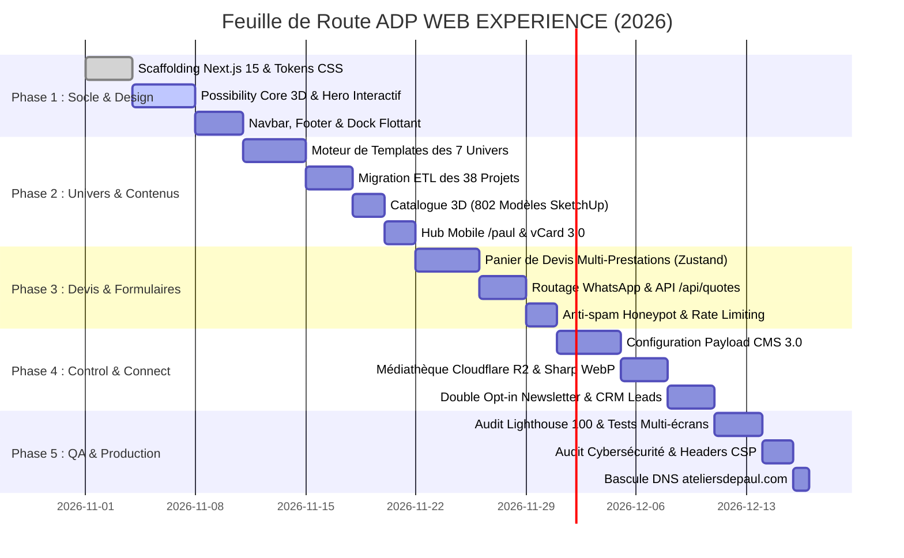

# ADP WEB EXPERIENCE — Rapport 03A-11 : Feuille de Route Opérationnelle du MVP et Phases Ultérieures

**Date :** 27 octobre 2026  
**Auteurs :** Responsable DevOps, Architecte Logiciel Senior, Responsable QA  
**Projet :** ADP WEB EXPERIENCE (`ateliersdepaul.com`)  
**Statut :** Planification stratégique et jalons de livraison — Étape 03A  

---

## 1. Principes de la Trajectoire MVP (Minimum Viable Product)

Pour garantir une livraison rapide, sans régression et avec un niveau de qualité sans concession, le développement d'**ADP WEB EXPERIENCE** est découpé en **cinq phases progressives**.

Le MVP (Phases 1 à 4) concentre les fonctionnalités indispensables pour remplacer avantageusement le site historique :
- Expérience d'accueil *The Possibility Machine* complète (Thème Clair Minéral par défaut) ;
- Présentation enrichie des 7 univers ADP ;
- Migration intégrale des 38 projets architecturaux et des 802 modèles SketchUp ;
- Panier de sélection de devis multi-univers avec transmission WhatsApp prioritaire et stockage en BDD ;
- Carte de visite numérique `/paul` avec vCard 3.0 et QR Code ;
- Back-office unifié ADP Control (Payload 3.0) pour l'administration autonome ;
- Zéro régression SEO grâce à la sanctuarisation des 69 URL historiques.

---

## 2. Décomposition Détaillée des Cinq Phases du MVP

---

### PHASE 1 : Fondations Applicatives, Design System et The Possibility Machine
- **Objectif :** Poser les bases techniques d'une application stable et implémenter le cœur visuel immersif.
- **Livrables :**
  1. Initialisation propre du projet Next.js 15 avec TypeScript strict et App Router ;
  2. Configuration du fichier `tokens.css` et implémentation du **Thème Clair Minéral Sophistiqué par défaut** (avec bascule Mode Sombre optionnelle) ;
  3. Composant vivant *The Possibility Core* (géométrie 3D pure CSS, rotations accélérées GPU, grain tactile SVG) ;
  4. Moteur de sélection des 6 intentions avec mise en valeur réactive des univers connectés ;
  5. Composants partagés : Barre de navigation adaptative (`<Navbar />`), Pied de page (`<Footer />`), et pastille d'action rapide (`<ContactDock />`) ;
  6. Prise en charge native de l'accessibilité (`prefers-reduced-motion`) et maintien du curseur système standard.
- **Critère de validation (Quality Gate) :** Le prototype HTML existant est fidèlement reproduit en React avec 60 images par seconde mesurées sur mobile.

---

### PHASE 2 : Architecture des Sept Univers, Migration des Projets et Ressources 3D
- **Objectif :** Remplacer les 62 pages HTML statiques du legacy par des routes dynamiques typées.
- **Livrables :**
  1. Moteur de templates universel pour les 7 pôles (`/adp-project`, `/adp-studio`, `/rosbri-design`, etc.) avec injection de la couleur d'accent et de l'encart déontologique ONAC ;
  2. Exécution du script ETL d'ingestion des 38 études de cas réelles dans PostgreSQL avec extraction des métadonnées (surfaces, logiciels, localisation au Cameroun) ;
  3. Téléversement et liaison des 38 images WebP de couverture optimisées ;
  4. Galerie de projets filtrable avec recherche instantanée par mots-clés ;
  5. Ingestion et affichage paginé du catalogue des 802 modèles SketchUp (`/ressources`) ;
  6. Déploiement de la carte de visite numérique mobile `/paul` avec téléchargement vCard 3.0 conforme UTF-8 et QR Code vectoriel ;
  7. Configuration des règles de redirection 301 pour les 69 URL historiques.
- **Critère de validation :** Zéro lien brisé sur l'ensemble de la cartographie issue de l'audit 02B.

---

### PHASE 3 : Moteur de Devis Multi-Sélection, WhatsApp et Formulaires Sécurisés
- **Objectif :** Activer la génération de prospects et canaliser les échanges vers les canaux directs.
- **Livrables :**
  1. Tiroir latéral de sélection de devis (Quote Drawer) avec persistance dans le navigateur (`useQuoteStore`) ;
  2. Possibilité d'ajouter des prestations et des modèles depuis n'importe quel univers en un clic ;
  3. Générateur de brief structuré et routage instantané vers le numéro officiel WhatsApp (`+237690087213`) ;
  4. Route API serveur `/api/quotes` pour archiver chaque demande en base PostgreSQL avec référence unique (`DEV-2026-XXXX`) ;
  5. Sécurisation anti-spam par champ honeypot invisible et limitation de débit (rate limiting) ;
  6. Formulaire de contact général avec redirection de confirmation (`/contact/merci`).
- **Critère de validation :** Une demande composée de 3 prestations distinctes est transmise sur WhatsApp et enregistrée en BDD en moins de 2 secondes.

---

### PHASE 4 : Déploiement d'ADP Control (Payload 3.0) et Fondamentaux d'ADP Connect
- **Objectif :** Rendre l'équipe d'ADP 100% autonome dans la gestion éditoriale et commerciale.
- **Livrables :**
  1. Activation du panneau sécurisé `/admin` propulsé par Payload CMS 3.0 ;
  2. Configuration des 14 collections MVP et des permissions RBAC (SuperAdmin, Éditeur, Commercial) ;
  3. Médiathèque intelligente avec conversion automatique Sharp en WebP et stockage Cloudflare R2 ;
  4. Boîte de réception des devis avec suivi des statuts (Nouveau ➔ En cours ➔ Gagné) et export CSV ;
  5. Module d'inscription à la newsletter avec processus de double opt-in conforme (envois via Resend/Brevo) ;
  6. Calendrier éditorial unifié et générateur de textes multi-réseaux (1 sujet ➔ 6 déclinaisons) ;
  7. Cockpit de prévisualisation SEO Google et Open Graph dynamique.
- **Critère de validation :** Paul Boubert peut créer un nouveau projet et publier une actualité sans ouvrir un éditeur de code.

---

### PHASE 5 : Assurance Qualité, Cybersécurité et Bascule en Production
- **Objectif :** Garantir une robustesse technique absolue avant l'ouverture publique.
- **Livrables :**
  1. Audit de performance Lighthouse sur desktop et mobile 4G : scores visés > 95 en Performance, 100 en Accessibilité, 100 en SEO et 100 en Bonnes Pratiques ;
  2. Tests multi-appareils (iPhone Safari, Android Chrome, tablettes, moniteurs 4K) ;
  3. Audit de sécurité des en-têtes HTTP (CSP stricte, HSTS, X-Frame-Options, anti-sniffing) ;
  4. Procédure de sauvegarde quotidienne automatisée (`pg_dump` + snapshot R2) ;
  5. Bascule transparente du domaine `ateliersdepaul.com` sur le nouveau projet Vercel sans coupure de service.
- **Critère de validation :** Validation sans réserve du rapport d'audit QA final.

---

## 3. Périmètre des Phases Post-MVP (Phases 6 et 7)

Les fonctionnalités suivantes sont explicitement exclues du MVP initial et programmées pour des évolutions ultérieures :

| Fonctionnalité Post-MVP | Phase Cible | Justification du Report |
|---|:---:|---|
| **Paiement en ligne (Mobile Money MTN/Orange)** | Phase 6 | Aucun besoin d'encaissement direct au lancement ; les ventes d'architecture et de mode se concluent sur devis et contrat. |
| **Espace Membre & Comptes Clients** | Phase 6 | Inutilement contraignant pour les visiteurs ; la fluidité du devis sans compte maximise la conversion. |
| **Publication Automatique par API Réseaux Sociaux** | Phase 6 | Nécessite des approbations d'entreprises lentes (LinkedIn Partner, Meta Business Verification) non critiques au jour 1. |
| **WhatsApp Cloud API (Bot conversationnel automatisé)** | Phase 7 | Le contact humain direct avec Paul Boubert via `wa.me` est infiniment plus qualitatif pour des contrats d'ingénierie haut de gamme. |
| **Visionneuse 3D WebGL / IFC temps réel dans le navigateur** | Phase 7 | Gourmande en bande passante mobile ; les galeries de rendus 4K et axonométries suffisent amplement pour convaincre. |
