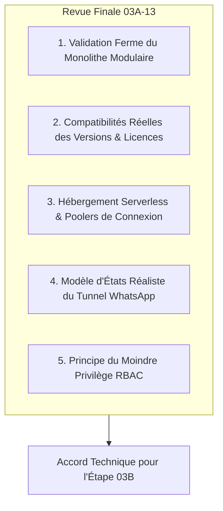
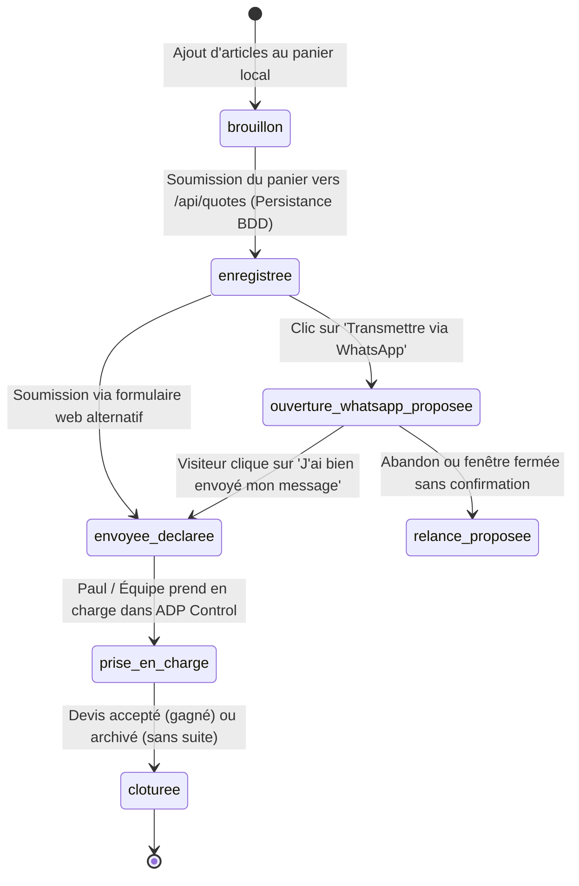

# ADP WEB EXPERIENCE — Rapport 03A-13 : Revue de Cohérence Finale et Ajustements Pré-Initialisation

**Date :** 27 octobre 2026  
**Auteurs :** Le Comité des Dix Experts Réuni (Architecte Logiciel Senior, Expert Next.js / React 19, Architecte BDD PostgreSQL, Expert Payload CMS, Designer UX/UI, Expert Cybersécurité, Responsables DevOps et QA)  
**Projet :** ADP WEB EXPERIENCE (`ateliersdepaul.com`)  
**Statut :** Document de validation formelle et d'ajustements pré-03B — Étape 03A  

---

## 1. Synthèse de la Revue de Cohérence

À l'issue de l'analyse croisée des 12 rapports d'architecture rédigés à l'étape 03A, des audits de l'étape 02B et du prototype `ADP_Possibility_Machine_Prototype.html`, le comité d'ingénierie confirme la solidité de la conception tout en apportant des **ajustements de rigueur indispensables** avant le lancement de l'étape 03B.

---

## 2. Vérification Approfondie des Décisions Architecturales

### 2.1. Confirmation du Monolithe Modulaire
Le choix d'un **monolithe modulaire** (Next.js 15 App Router avec Payload CMS 3.0 embarqué au sein du même runtime) est **pleinement réaffirmé** :
- **Suppression du risque réseau inter-services :** Dans une architecture découplée (ex. Next.js sur Vercel + Strapi sur Render), chaque page publique dépend d'un appel HTTP distant vers le CMS. Une indisponibilité ou latence du CMS dégrade instantanément le site public.
- **Accès direct aux données (Local API) :** Les Server Components de Next.js interrogent directement PostgreSQL via la méthode `payload.find()` sans surcoût de sérialisation HTTP.
- **Typage End-to-End vérifié :** La génération automatique des types TypeScript depuis la configuration des collections Payload garantit que toute modification du schéma de données est immédiatement répercutée dans les composants React.

### 2.2. Matrice des Compatibilités Réelles et Versions Recommandées
Les versions suivantes sont formellement validées pour le scaffolding de l'étape 03B :

| Composant | Version Recommandée | Statut & Support Documenté | Licence | Justification & Références |
|---|:---:|:---:|:---:|---|
| **Node.js** | **v20.x LTS** (Iron) ou **v22.x LTS** | Active LTS | OpenJS / MIT | Requis par Next.js 15 et Payload 3.0 (minimum Node 18.20.2+, 20.9.0+ recommandé). |
| **Next.js** | **15.1.x** | Dernière version stable GA | MIT | Support natif de React 19, de l'App Router et des Server Actions stabilisées. |
| **React** | **19.0.0** | GA stable | MIT | Pris en charge nativement par Payload 3.x et Next.js 15. |
| **TypeScript** | **5.6.x** | Stable | Apache 2.0 | Mode `strict: true` avec typage exhaustif des Server Actions. |
| **Payload CMS** | **3.x (Latest Stable)** | GA (App Router natif) | **MIT (100% libre)** | `@payloadcms/next`, `@payloadcms/db-postgres`, `@payloadcms/richtext-lexical`. |
| **PostgreSQL** | **16.x** | Version active | PostgreSQL (BSD-like) | Support JSONB avancé, index GIN et robustesse éprouvée. |
| **Sharp** | **0.33.x** | Stable | Apache 2.0 | Traitement d'images haute performance WebP côté serveur. |
| **Zod** | **3.23.x** | Stable | MIT | Validation partagée client/serveur des formulaires et devis. |

### 2.3. Conditions de Déploiement sur Vercel et Contraintes Serverless
Le déploiement de Payload CMS 3.0 sur Vercel implique trois règles d'ingénierie strictes :
1. **Épuisement des connexions PostgreSQL (Connection Exhaustion) :**
   - *Problème :* Dans un environnement serverless comme Vercel, chaque fonction instanciée ouvre une connexion directe à PostgreSQL. Sans régulation, un pic de 50 visiteurs simultanés peut saturer le pool de la base (souvent limité à 20-50 connexions sur les offres standard).
   - *Solution impérative :* Utiliser impérativement une URL de connexion avec **pooler de transactions** (ex. Neon Connection Pooling via port 5432 / `-pooler`, ou Supabase Supavisor sur port 6543).
2. **Temps d'exécution maximal (Timeout Serverless) :**
   - Vercel limite l'exécution d'une fonction serverless à 15 secondes (Hobby) ou 60 à 300 secondes (Pro).
   - *Règle :* Les opérations lourdes (ex. ingestion batch de 802 modèles) doivent être exécutées via des scripts locaux CLI (`scripts/migrate-*.ts`) et non via une route API web exposée.
3. **Persistance des fichiers éphémères :**
   - Le système de fichiers local (`/tmp`) de Vercel étant éphémère et réinitialisé à chaque cold start, aucun fichier uploadé ne doit être écrit sur disque local. Tous les médias transitent obligatoirement vers le stockage objet externe via `@payloadcms/storage-s3`.

### 2.4. Examen Critique des Fournisseurs : Cloudflare R2, Neon et Supabase

| Fournisseur | Rôle dans ADP | Offre Gratuite (Démarrage) | Coût Vitesse de Croisière | Points de Vigilance & Décision |
|---|---|---|---|---|
| **Cloudflare R2** | Stockage Médias (S3) | **10 Go gratuits**, 10M lectures/mois, 1M écritures/mois | 0,015 $/Go/mois | **VALIDÉ : Zéro frais de transfert sortant (Zero Egress)**. Idéal pour les rendus 4K et modèles 3D. |
| **Neon PostgreSQL** | Base de données | 0,5 GiB stockage, 1 vCPU partagé, extinction auto | ~19 $/mois (Launch) | **VALIDÉ : Connection Pooling natif**, branchement de base de données instantané (branching) pour les tests. |
| **Supabase Postgres** | Alternative BDD | 500 Mo stockage, pooler Supavisor inclus | ~25 $/mois (Pro) | *Alerte :* Mise en pause automatique des projets gratuits après 7 jours d'inactivité. Nécessite un réveil manuel. |

👉 **Arbitrage retenu :** **Neon Serverless PostgreSQL** est le choix n°1 recommandé pour le moteur de données en raison de sa résilience serverless et de son pooling intégré, combiné à **Cloudflare R2** pour les fichiers.

---

## 3. Rectifications et Précisions des Spécifications Métiers

### 3.1. Thème et Identité Visuelle
- Le **Thème Clair Minéral Sophistiqué** (fond pierre/ivoire `#F9F8F5`, surfaces lin `#F0EFEA`, accents laiton/bronze `#C59B53`, typographies ardoise `#1A222D`) est formellement confirmé comme **thème principal par défaut**.
- Le **Mode Sombre d'Atelier** (`#0C1422`, accents or chaud `#E9BD7A`) est maintenu comme **option utilisateur**, accessible via bascule ou détection automatique de `prefers-color-scheme`.
- L'intégrité des **sept univers ADP** est sanctuarisée :
  1. *ADP Project* (Architecture, BIM, 3D, respect strict du cadre déontologique ONAC) ;
  2. *ADP Studio* (Design graphique, branding, print) ;
  3. *Rosbri Wax Design* (Mode contemporaine, textile africain) ;
  4. *ADP Brief* (Rédaction stratégique, mémoires techniques) ;
  5. *ADP Lab* (R&D bioclimatique, expérimentations) ;
  6. *ADP Academy* (Formations professionnelles) ;
  7. *ADP Tools* (Logiciels, scripts Revit/Dynamo).
- **Zéro compte client obligatoire et zéro paiement bancaire en ligne au MVP** : La conversion repose sur l'excellence du conseil et le chiffrage sur-mesure.

---

### 3.2. Nouveau Modèle d'États du Tunnel de Devis et WhatsApp

L'une des rectifications majeures apportées par cette revue consiste à **ne jamais assimiler une redirection WhatsApp à un envoi confirmé** :

#### Définition Formelle des Six États :
1. `brouillon` : Sélection en cours dans le navigateur du visiteur (stockée dans Zustand / LocalStorage), aucune écriture en base.
2. `enregistree` : Le formulaire de coordonnées est validé et les données sont **physiquement persistées dans PostgreSQL** via `POST /api/quotes` avec génération de la référence `DEV-YYYYMM-XXXX`. **Cette étape intervient obligatoirement AVANT toute redirection externe.**
3. `ouverture_whatsapp_proposee` : L'URL `wa.me/237690087213?text=...` a été générée et ouverte dans le navigateur ou l'application du client. À cet instant, rien ne prouve que le client a effectivement appuyé sur le bouton "Envoyer" de WhatsApp.
4. `envoyee_declaree` : Le visiteur a cliqué sur le bouton de réassurance *"J'ai bien transmis mon message sur WhatsApp"* affiché sur la page de confirmation, ou a choisi l'envoi direct par formulaire web.
5. `prise_en_charge` : Paul Boubert ou un collaborateur a ouvert la fiche dans ADP Control et a qualifié le dossier (contact téléphonique établi, étude de faisabilité en cours).
6. `cloturee` : Clôture formelle de la demande (devis validé, mission contractualisée ou dossier classé sans suite).

---

### 3.3. Matrice RBAC avec Principe du Moindre Privilège

Pour garantir qu'aucun compte n'ait accès à des données non requises par sa mission :

| Rôle Administratif | Utilisateur Cible | Droits Concédés (Strict Minimum) | Restrictions Absolues |
|---|---|---|---|
| **SuperAdmin** | Paul Boubert | Accès universel : Utilisateurs, BDD, Devis, Logs, Clés API, SEO, Univers. | Aucune. |
| **Commercial / Support** | Responsable Clientèle | Lecture et mise à jour des statuts des `contacts`, `quote_requests` et `leads`. | **Interdiction totale** d'accès aux paramètres système, aux utilisateurs, aux logs et à la suppression de projets. |
| **Éditeur en Chef** | Responsable Communication | Création, modification et publication sur `projects`, `universes`, `articles`, `media`, `social_posts`. | **Interdiction totale** de consulter les données financières et coordonnées des devis/contacts entrants. |
| **Rédacteur / Contributeur** | Stagiaire / Graphiste externe | Création de brouillons (`status: draft`) sur les projets et téléversement de médias temporaires. | **Interdiction formelle de publier en direct** et aucun accès aux devis ni aux réglages. |

---

### 3.4. Distanciation Réaliste des Intégrations Réseaux Sociaux

Pour écarter toute ambiguïté technique :
- **MVP (Immédiat) :** Déploiement d'un **Hub Éditorial Intelligent (1 Sujet ➔ 6 Formats)**. L'équipe rédige un sujet pivot ; ADP Connect génère les variantes pour LinkedIn, Instagram, Facebook, X, WhatsApp et le Site Web avec boutons de copie rapide et liens d'ouverture manuelle.
- **Phase 6 (Post-MVP) :** Automatisation par API (LinkedIn Community Management API et Meta Graph API) programmée uniquement après obtention des vérifications d'entreprises officielles.

---

## 4. Audit de Robustesse du Modèle de Données

La structure à 25 collections définie au rapport [03A_03_MODELE_DONNEES.md](file:///d:/05_ADP_SOFTWARE/00_ADP%20WEB%20EXPERIENCE/02_AUDIT/03A_03_MODELE_DONNEES.md) a été soumise à une analyse de cohérence relationnelle :

### 4.1. Vérification des Relations et Dépendances Circulaires
- **Résultat :** **Zéro dépendance circulaire.**
- La hiérarchie est strictement unidirectionnelle :
  `universes` ➔ `services` / `products` ➔ `quote_items` ➔ `quote_requests` ➔ `contacts`.
- La table `categories` utilise une auto-référence (`parent_id`) strictement hiérarchique avec contrainte d'absence de cycle (`CHECK (id != parent_id)`).

### 4.2. Collections Vitales pour le MVP (14 Collections Prioritaires)
Pour éviter tout éparpillement lors de l'étape 03B, les collections sont ordonnées en deux vagues d'activation :
1. **Socle MVP Immédiat (14 collections) :** `users`, `roles`, `universes`, `pages`, `projects`, `project_media`, `media`, `resources`, `categories`, `services`, `contacts`, `quote_requests`, `quote_items`, `redirects`, `site_settings`, `audit_logs`.
2. **Extensions Secondaires (Phase 2 & 3) :** `products`, `product_variants`, `collections_tax`, `articles`, `leads`, `social_posts`, `campaigns`, `newsletter_subscribers`, `forms`.

---

## 5. Conclusion et Feu Vert pour l'Étape 03B

Le comité des dix experts valide unanimement l'ensemble des corrections ci-dessus.  
L'architecture cible est déclarée **cohérente, sécurisée, réaliste et prête pour la phase d'initialisation technique (Étape 03B)** détaillée dans le document [03B_00_PLAN_INITIALISATION.md](file:///d:/05_ADP_SOFTWARE/00_ADP%20WEB%20EXPERIENCE/02_AUDIT/03B_00_PLAN_INITIALISATION.md).
